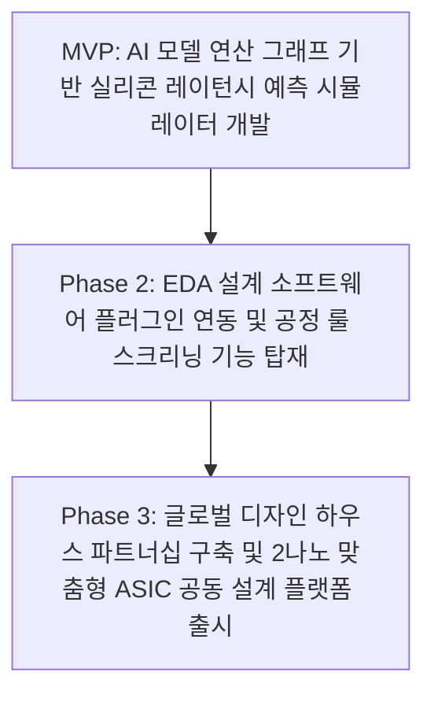

실행시간 : 2026-07-04_142224

# SemiFabric-AI (세미패브릭 AI): 앤트로픽/메타 최적화 2나노 차세대 ASIC 물리 레이아웃 자동 MLOps 솔루션

## 1. 아이디어명
- **SemiFabric-AI (세미패브릭 AI)**: 2나노 삼성 파운드리 공정 최적화 커스텀 AI 반도체(ASIC) 자동 합성 및 물리 레이아웃 MLOps 사전 검증 솔루션

## 2. 제안 범위 및 카테고리
- **대분류**: 데이터 및 인공지능 (Data & AI)
- **중분류**: MLOps 및 가속기 반도체 데이터 인프라 (Silicon-MLOps)

## 3. 해결 문제와 사용자 페르소나
- **해결하고자 하는 핵심 문제**:
  - LLM 모델 구동에 상상을 초월하는 전기 요금과 컴퓨팅 비용이 들어가면서, 글로벌 랩스(앤트로픽, 메타 등)는 엔비디아 의존도를 줄이고 자사 알고리즘에 딱 맞춘 커스텀 AI 가속칩(ASIC)을 개발하고 삼성 파운드리의 최신 2나노 미세 공정 투입을 가속하고 있음.
  - 하지만, 소프트웨어인 AI 알고리즘의 텐서 플로우 연산 그래프를 실물 반도체의 실리콘 레이아웃으로 변환하는 과정(합성 및 Place & Route)에서 거대한 공정 지식 병목이 발생함.
  - AI 소프트웨어 설계와 실물 실리콘 공정(2나노 삼성 선단 공정 등) 간의 데이터 단절로 인해 한 번의 Tape-Out 실패에 수백억 원의 추가 비용과 수개월의 타임투마켓 지연이 발생함.
- **사용자 페르소나**:
  - **최지수 (38세, 인공지능 가속 팹리스 스타트업 실리콘 설계 헤드)**: 대규모 트랜스포머 연산을 저전력으로 구동할 자체 가속 칩을 설계 중인 인공지능 하드웨어 아키텍트. 앤트로픽과 삼성이 제휴했다는 기사를 보고 2나노 선단 공정을 목표로 잡았으나, 칩의 물리 합성 단계에서 소프트웨어의 병렬 처리 구조가 하드웨어 셀 구조와 끊임없이 어긋나며 합성 시뮬레이션 에러와 시간 낭비에 직면함.

## 4. 핵심 기능/차별점
- **AI-to-Silicon 텐서 프로파일링 컴파일러**:
  - 소프트웨어 레이어의 뉴럴 네트워크 구조(Attention Head, MLP 레이어)를 물리 반도체 실리콘 다이(Die)의 2나노 트랜지스터 밀도와 로직 셀(Logic Cell) 매칭 수준으로 정밀 파싱하고 데이터 패스 최단 경로를 모델링함.
- **파운드리 공정 규칙 사전 검증 MLOps 섀도우 시뮬레이터**:
  - 삼성 파운드리 최선단 2나노 설계 자산(PDK/IP) 및 설계 룰을 머신러닝 모델에 학습시켜, 실제 물리 하드웨어 제조 전에 레이아웃 단계의 누설 전류, 열 밀도, 연산 레이턴시를 99% 정밀도로 실시간 스크리닝함.
- **최적의 메모리 하이어라키(HBM/SRAM) 배치 제안 기능**:
  - LLM 병목의 최대 원인인 메모리 대역폭을 해결하기 위해, 칩 내부에 내장되는 SRAM 및 인터포저 상의 HBM 물리 레이어 간 데이터 병목 지점을 데이터 중심 AI 모델로 예측하여 컴포넌트 간 물리적 거리와 배선을 자동 조율함.

## 5. 실행 계획 (MVP -> 확장)

- **MVP 단계**: 텐서플로우/파이토치(PyTorch) 모델 파일을 넣으면 해당 연산 구조가 가상 ASIC 상에서 가질 실리콘 면적, 추정 소모 전력, 예측 연산 지연시간을 수초 만에 계산해 주는 클라우드 시뮬레이터 베타 버전 배포.
- **Phase 2 (도구 융합)**: 시놉시스(Synopsys), 케이던스(Cadence) 등 전문 반도체 설계 소프트웨어(EDA)의 레이아웃 배선 툴과 플러그인 형태로 실시간 상호 호환되는 AI 기반 Place & Route 도우미 엔진 개발.
- **Phase 3 (디자인 하우스 연동)**: 디자인 하우스 및 파운드리 에코시스템과 제휴해 가상 테이프아웃(Virtual Tape-Out) 인증서를 발급하고 칩 생산 수율 보장 프로그램으로 안심 출시 생태계 선점.

## 6. 수익 모델
- **엔터프라이즈 MLOps 라이선스료**:
  - 스타트업 라이선스: 연 12,000달러 (최대 3개 커스텀 칩 아키텍처 모델링 지원).
  - 테크 기업/엔터프라이즈 라이선스: 연 85,000달러 (삼성 2나노 포함 선단 공정 PDK 섀도우 시뮬레이션 지원, 하드웨어 공동 튜닝 가이드 무제한 제공).
- **성공 보수 인센티브 (수율 개선 보너스)**:
  - Tape-Out 성공 및 반도체 수율(Yield) 향상에 따라 제조 비용 절감액의 5%를 성능 인센티브 보너스로 정산 수취.

## 7. 일정/리소스 계획
- **개발 기간**: 총 6개월 (물리 물리 엔진 데이터 모델링 3개월, 파운드리 설계 룰 학습 3개월)
- **필요 리소스**:
  - 반도체 설계(EDA/CAD) 유경험 엔지니어 2명
  - AI 가속 아키텍처/컴파일러 전문가 1명
  - MLOps 클라우드 백엔드 개발자 1명

## 8. 실현 가능성 점수 및 근거
- **실현 가능성 점수**: **4.2 / 5.0**
- **근거**:
  - 삼성전자가 앤트로픽, 메타 등의 대형 물량을 확보했다는 사실은 AI 스타트업 진영에서도 맞춤형 칩 생산에 도전하는 붐을 촉발할 수밖에 없는 강력한 증거임.
  - 고가의 반도체 설계 영역에서 가상 MLOps 사전 검증을 거치는 것만으로도 수십 억 원에 달하는 마스크 제작 오류와 재설계 비용을 예방할 수 있으므로, 하이테크 기업들의 투자 가치(ROI)가 완벽하게 일치함.

## 9. 참고 RSS FEED
- **참고 RSS FEED 제목**: 앤트로픽에 메타까지…AI칩 주도권 품은 삼성 파운드리 - 서울경제신문 / 자체 AI칩 개발 뛰어든 앤스로픽, 파운드리 파트너로 삼성 낙점 - 동아일보
- **링크**: [링크 1](https://news.google.com/rss/articles/CBMiUkFVX3lxTE1aRjVHc2ZkbzJvRGZaUDJPTHlMYklPaWN3LXVuN2wyTHlNZ2JhYWhpbzEya3p2M21HWU4xZmtlLS1ZNWJWbF9LS3hGVVpENUFwdXfSAVNBVV95cUxPNERqeVZPN1p3eHVpMUtwclFSV2dXWGNMNnVwdjh1WHQyaXRXbzBLMEh6Z3U3N25wUmxnSFFCbTRSRk1Bd2lWODZvcndTX01wNWlSVQ?oc=5) / [링크 2](https://news.google.com/rss/articles/CBMidkFVX3lxTFBfZmNldXF3SlEtTkVSRXBmTjIxR1pFbFJkdFR5X05Gd3lCRy0wVU1lR1IwSkJJam11TE4tbk5tNXZrQ0hZRVZXR3JERWdtQzVJWXhYU3VMemJ1RFNrR0M1UUlDc0ZnVHJxcVlQcERQRVFBdzljeVHSAWZBVV95cUxNR3R0a3YtZDdLclJBNkdNV3R0MWV6ZjVoclE4bUg3cDNjY1E4ckxkNl9scGdLWjNlRVhjQ0Q3UDk3eE1PWjl6cU81Vm1senZuNHVhWFJjZGlqRVZoX0Yyalhrb1N1WHc?oc=5)
- **요약정보**: 삼성전자가 테슬라에 이어 메타, 앤트로픽까지 초격차 2나노 최선단 파운드리 공정의 핵심 연동 설계를 위탁받는 등 대규모 수주 시대를 열어제끼고 있습니다. AI 모델에 최적화된 저전력 초고성능 주문형 반도체(ASIC) 맞춤형 물리 레이아웃 설계 검증 수요가 급증하는 강력한 근거입니다.
