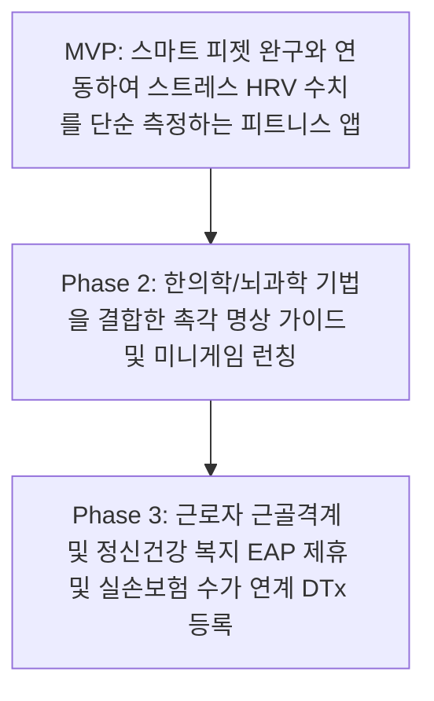

실행시간 : 2026-07-04_142224

# MindClay-Heal (마인드클레이 힐): IoT 햅틱 센서 연동 실시간 스트레스 진단 및 촉각 바이오피드백 디지털 치료제

## 1. 아이디어명
- **MindClay-Heal (마인드클레이 힐)**: 왁스/점토 기반 스마트 IoT 햅틱 피젯 연동 마음 건강 케어 및 실시간 디지털 치료제(DTx) 플랫폼

## 2. 제안 범위 및 카테고리
- **대분류**: 서비스 및 플랫폼 (IT Services)
- **중분류**: 디지털 헬스케어 및 웰니스 플랫폼 (Digital Healthcare & Insurtech)

## 3. 해결 문제와 사용자 페르소나
- **해결하고자 하는 핵심 문제**:
  - 현대 직장인과 수험생들은 과도한 디지털 스크린 시청, 고도의 집중 작업으로 인한 만성 긴장, 두통, 번아웃 증상을 겪고 있음.
  - 기존의 명상 앱이나 정신건강 관리 앱들은 화면을 보며 음악을 듣는 일방향 방식이어서 즉각적인 육체적 신경 완화를 주지 못하며, 시각 자극에 대한 역효과마저 있음.
  - 인체 신경망은 무언가를 손으로 만지고 부수는 손동작(만지작거림)을 할 때 피부 촉각이 활성화되며 즉각적으로 뇌의 통증 제어 메커니즘을 깨우는데, 기존 스트레스 완화 완구(피젯 토이, 왁뿌볼 등)는 단순 유행성에 머물며 치료/모니터링 효과의 정량적 트래킹이 불가능함.
- **사용자 페르소나**:
  - **이지은 (32세, 테크 기업 UI 디자이너)**: 매일 10시간 이상 PC와 스마트폰으로 일하며 화면 피로가 극에 달해 만성 긴장형 두통에 시달림. 근무 중간 명상 앱을 켜도 눈이 시려 꺼버리기 일쑤고, 손으로 왁스 장난감을 무의식적으로 누를 때 안정감을 느낌. 손동작이 마음 건강과 치료 실적으로 연동되는 디지털 보증 케어 플랫폼이 필요함.

## 4. 핵심 기능/차별점
- **센서 내장 스마트 IoT 파쇄 공(Smart Squeeze Ball)**:
  - 왁스의 질감과 점토의 유연함을 물리적으로 구현한 표면 내부에 정밀 압력 센서 및 가속도계를 탑재하여, 꽉 쥐고(Squeeze), 왁스를 부수고(Shatter), 주무르는 손동작의 미세 세기를 실시간 디지털 데이터로 파싱.
- **뇌 뇌파 및 자율신경 연동 촉각 바이오피드백(Biofeedback) 스마트 매치**:
  - 사용자가 IoT 공을 만질 때 맥박 전도율과 스마트 워치 센서의 심박 변이도(HRV)를 실시간 융합하여 부교감신경 활성도 점수를 스마트폰에 수치화.
- **목표 지향적 마음 치유 미니게임 및 정량 진단 대시보드**:
  - 압력 패턴에 맞춰 적절한 힘으로 이완하는 촉각 피드백 명상 가이드, 부수고 터트리는 타격감을 모바일 화면에 감성 그래픽으로 렌더링하는 명상 시나리오 탑재.
- **직장인 스트레스 상호 완화 배틀 및 보상 인프라**:
  - "오늘의 스트레스 파쇄" 랭킹, 동료들과 익명으로 함께 공을 쥐며 스트레스를 날려버리는 커뮤니티 공간 제공.

## 5. 실행 계획 (MVP -> 확장)

- **MVP 단계**: 3D 프린팅으로 제작된 하드웨어 햅틱 마우스 형태의 점토 센서 기기와 블루투스 앱을 매칭해 사용자의 하루 촉각 피젯 시간과 주무르는 압력 세기 변화를 모니터링하는 패키지 출시.
- **Phase 2 (웰니스 고도화)**: 왁스 표면에 미세 열선 및 스마트 피드백 압력 구동 모듈을 장착하여, 앱이 지시하는 가이드에 따라 온도가 오르내리고 딱딱해졌다 말랑해지며 손 신경을 고도로 자극하는 액티브 햅틱 명상 서비스 구현.
- **Phase 3 (메디컬 확장)**: 뇌 신경과학 전문의들과 공동 임상을 진행하여 병원의 심리 치료 수가나 디지털 치료기기(DTx) 정식 승인 절차 밟기 및 실손 보험 할인 혜택 연동.

## 6. 수익 모델
- **D2C 하드웨어 + 앱 패키지 판매**:
  - 스타터 키트 (스마트 IoT 구체 + 전용 이완 점토 3팩 + 앱 평생 이용권): 189,000원.
  - 주기적인 점토 리필팩 정기 구독: 월 9,900원.
- **B2B 근로자 복지 프로그램(EAP) 모델**:
  - 사내 직장인 스트레스 휴게소에 전용 햅틱 기기 존 설치 및 월 관리 수수료 수취.
- **디지털 헬스 보장 연계 (Insurtech)**:
  - 보험사와 연계해 하루 촉각 햅틱 미션을 15분 이상 완수하여 정신 스트레스 수치가 안정 상태를 유지하면 실손보험료의 2~5%를 페이백 캐시로 돌려주는 리워드 제휴 수수료.

## 7. 일정/리소스 계획
- **개발 기간**: 총 5개월 (하드웨어 시제품 금형 및 센서 보드 설계 3개월, 헬스케어 동기화 백엔드 개발 2개월)
- **필요 리소스**:
  - 하드웨어 및 금형/제품 디자이너 1명
  - 모바일 앱 및 임베디드 펌웨어 엔지니어 1명
  - 임상/헬스케어 콘텐츠 기획자 1명

## 8. 실현 가능성 점수 및 근거
- **실현 가능성 점수**: **4.4 / 5.0**
- **근거**:
  - 최근 SNS 릴스 및 쇼츠에서 '왁뿌볼(왁스 부수기)'의 누적 조회수가 수천만 회를 넘어가며 동묘 완구거리 등에서 조기 완판되는 기염을 토하고 있을 만큼 압도적인 대중적 흥미 요소가 입증됨.
  - 단순 오락거리 장난감에 머물던 촉각 문화를 IBS(기초과학연구원) 뇌이미징연구단의 '촉각 만지기 실험 기반 뇌의 통증 제어 매커니즘 효과 실증'이라는 저명한 과학적 실험 성공 결과를 근거로 삼았기 때문에, 시장에서 의학적 신뢰도와 구매 설득력을 가질 수 있어 매우 현실성 높음.

## 9. 참고 RSS FEED
- **참고 RSS FEED 제목**: 왁뿌볼, 만지면 통증 덜 느껴진다?…‘말랑’과 ‘뽀각’의 과학 - v.daum.net
- **링크**: [링크](https://news.google.com/rss/articles/CBMiT0FVX3lxTE9oREFSVDR4RWVNNjNMcGZ2MnFGU3lPdWpBVjAtN2JyTmRVaXp4TUFOa09FRFVTcHZCQnhzMGJ4NXZQdGw0RzBtWlZEQzlsTG8?oc=5)
- **요약정보**: 소셜미디어에서 선풍적인 인기를 끌며 스트레스 해소제로 팔리고 있는 '왁뿌볼' 완구에 대해 IBS 뇌이미징연구단이 실제 인체 실험을 진행했습니다. 점토와 왁스를 부수고 조작하는 물리적 감각 행동이 뇌로 유입되는 통각 자극 경로를 경쟁 억제하여 실제 고통과 불안 심리를 진정시키는 뇌과학적 치료 효과가 정량 실증되었습니다.
