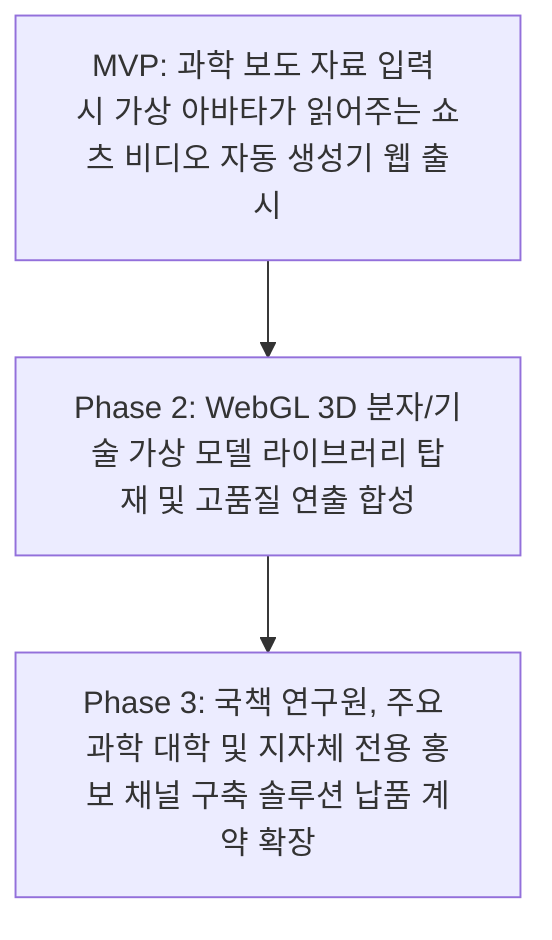

실행시간 : 2026-07-04_142224

# SciComm-Gen (사이컴 젠): 첨단 기술 특화 '팩트·임팩트' 3D 과학 시나리오 및 가상 과학 대변인 채널 운영 솔루션

## 1. 아이디어명
- **SciComm-Gen (사이컴 젠)**: 첨단 과학 기술 현안 전문 '팩트 기반 임팩트 스토리텔링' 및 버추얼 휴먼 영상 자동 생성 미디어 서비스

## 2. 제안 범위 및 카테고리
- **대분류**: 유튜브 콘텐츠 및 미디어 (YouTube & Media)
- **중분류**: AI 자동화 채널 및 버추얼 휴먼 과학 IP (AI Automation & Virtual IP)

## 3. 해결 문제와 사용자 페르소나
- **해결하고자 하는 핵심 문제**:
  - 에너지 대전환, 초거대 AI, 기후위기 등 고도로 전문적인 미래 과학 의제들은 연구 논문이나 보고서 형태의 딱딱한 글로만 남아 있어 대중의 교감과 이해도가 매우 낮음.
  - 이를 다루는 대다수 유튜브 과학 콘텐츠들은 자극성에만 치우쳐 팩트가 심하게 왜곡되거나 가짜 뉴스를 전파하여 정부 연구기관과 학계의 골칫거리가 됨.
  - 공공 학계와 지자체 과학단지(원주시, 한국에너지공과대 등)는 정부 홍보 예산을 들여 대중과의 소통(과학커뮤니케이션) 채널을 늘리고 싶어 하지만, 매번 막대한 3D 컴퓨터 그래픽(CG) 비용, 영상 편집 인력비, 전문 작가 섭외 병목으로 채널을 지속해서 운영하는 데 무리가 있음.
- **사용자 페르소나**:
  - **박상현 (45세, 국책 과학기술 연구단 대외협력실장)**: 인류의 에너지 기후 문제를 바꿀 첨단 바이오 소재를 개발해 널리 알리고자 함. 지자체 과학 인재 유치 예산 3억 원이 배정되었으나, 홍보 대행사가 만들어 준 고리타분한 홍보 동영상은 조회수 100회 미만으로 사장되어 속앓이 중임. 실시간 팩트와 트렌드를 실시간 가상 기술로 전환하여 조회수와 신뢰를 모두 잡는 혁신적 미디어 자동화 파트너가 필요함.

## 4. 핵심 기능/차별점
- **'팩트-임팩트(Fact-Impact)' 과학 논문 자동 각본 엔진**:
  - 팩트가 입증된 논문(PDF)이나 학회 발표록을 업로드하면, AI 각본 엔진이 "기승전결 내러티브 구조"와 "갈등/미스터리 해결" 구도를 도입해 흥미진진한 교양 다큐멘터리 각본 및 쇼츠 대본으로 자동 변환.
- **WebGL 기반 가상 3D 과학 분자/에너지 가상 인터랙티브 캔버스**:
  - 설명하는 과학 팩트에 일치하는 물리 분자, AI 반도체 로직 배선, 2차 전지 충방전 과정을 브라우저 상의 WebGL 기술을 사용해 고해상도 3D 인터랙티브 그래픽으로 즉시 렌더링하고 영상 내에 클립 오버레이로 합성.
- **과학 전문 버추얼 아바타 과학 대변인(Science Host) 탑재**:
  - 과학 문화 소통에 가장 신뢰감을 주도록 훈련된 커스텀 음성 톤(조용한 이성, 역동적 전달 등)과 외형을 장착한 가상 휴먼 아바타 호스트가 실시간 나레이션 및 제스처를 취하며 설명 제공.
- **멀티 채널 원클릭 퍼블리셔**:
  - 유튜브, 틱톡, 지자체 공식 웹사이트 등에 최적화된 화면 비율로 종횡 레이아웃을 자동 분할하고 언어별 실시간 번역 자막을 포함하여 동시 송출 및 시청 반응 빅데이터 분석 대시보드 연동.

## 5. 실행 계획 (MVP -> 확장)

- **MVP 단계**: 국책 과학기술 학회 및 정부 보도 자료의 텍스트를 파싱하여, 고품질 전문 성우 AI 오디오와 가상 아바타가 등장하는 60초 쇼츠 비디오를 즉시 빌드해 주는 클라우드 시뮬레이터 런칭.
- **Phase 2 (엔지니어링 접목)**: 설명 대상 과학 원리를 가상 인터랙티브 3D 캔버스 엔진과 연계하여 분자 구조, 반도체 웨이퍼 레이아웃 등이 오차 없이 카메라 움직임에 맞춰 아름답게 회전하고 분해되는 고난도 3D 비주얼 융합.
- **Phase 3 (B2G/B2B 확대)**: 대학(켄텍 등), 지자체(원주시 등 강원과학기술원 거점 유치 캠페인) 등 전문 과학 미디어 제작 수요를 연 단위 구독 형태(SaaS형 디자인 하우스)로 독점 수주하며 정부 공공 소통 미디어 표준 선점.

## 6. 수익 모델
- **공공/대학/지자체 전용 연간 채널 위탁 구독 모델 (B2G SaaS)**:
  - 라이트 요금제 (월 3개 영상 발행, 3D WebGL 모델 3개): 월 150만 원.
  - 프리미엄 소통 요금제 (월 10개 영상 발행, 실시간 연구성과 보도 자료 즉시 각본 변환, 독점 버추얼 호스트 개발): 월 450만 원.
- **3D 인터랙티브 과학 에셋 마켓플레이스**:
  - 고유한 물리 법칙이 적용된 3D 그래픽 과학 기술 시뮬레이션 에셋 제작 대행 및 다운로드 판매 (에셋당 30만 원~200만 원).

## 7. 일정/리소스 계획
- **개발 기간**: 총 4개월 (AI 각본 및 아바타 합성 자동화 구축 2개월, WebGL 3D 에셋 인터랙터 개발 2개월)
- **필요 리소스**:
  - 3D 프론트엔드/WebGL 엔지니어 1명
  - AI 생성 비디오 및 영상 합성 백엔드 엔지니어 1명
  - 모션 그래픽/비주얼 아티스트 1명

## 8. 실현 가능성 점수 및 근거
- **실현 가능성 점수**: **4.5 / 5.0**
- **근거**:
  - 국내 최초의 과학커뮤니케이션 전문 학술 단체 KCST의 출범은 정부와 산업계, 시민의 공론장 소통 예산이 제도적으로 늘어날 것을 약속하는 핵심 시그널임.
  - 강원과학기술원 유치 등 수백억 원 규모의 대형 지자체 인프라 경쟁에서 시민의 공감대와 정책 설문 참여를 이끌어 내려면, 지루한 지자체 홈페이지 공지 대신 사이컴 젠과 같은 고도로 정밀하고 흥미로운 미디어 채널이 최고 수준의 가치를 가짐.

## 9. 참고 RSS FEED
- **참고 RSS FEED 제목**: 켄텍 조숙경 교수, 국내 첫 과학커뮤니케이션 전문학회 초대 회장 선임 - 전기신문 / 원주시, '강원과학기술원' 유치 시민 설문조사 실시 - 연합뉴스
- **링크**: [링크 1](https://news.google.com/rss/articles/CBMibEFVX3lxTFBKQ3NBWEthZE5yXzgwQXYwWTFZXzFXbFBjVmRFX1BXLVlLdzhoNzBURzFSNG9SeWFLYXAwNzlEQ2djR0xRSENpcFhhdjlHOHIzMUYzR20tTmFtMkhLX1NSZ3ZoUE1oaTZJXzBlV9IBcEFVX3lxTE0tbUVwb284VVVfYmxzd1pobFA3WDhlbjktQ2JEM0xNUV9tOUR1RDVrcEdTU25lZWlhbTFqV3EyNWQzWWRKMGk1aG9uSWtyS0RoUkt0R3IyMm9JSUJWSFFYZ3F1RC13eTFrYTZDeTZTRi0?oc=5) / [링크 2](https://news.google.com/rss/articles/CBMiW0FVX3lxTE83cW90VG5LSHdhTjh0UWFXcGNfcGc1ZlBaNThwVy1WZW1LdkFZbmZBT2laYUx0WTRybkE4VE9MeXcwOTVHNUFUOGZQTlR1UmRMUllMWjFlckgtUmvSAWBBVV95cUxPZTgxTlFUak5ZZHpPNk9zZ2Q3elVUNmJoMFRmM0N1YlRqbHBOV0lmdlB4R2JIZ0w2SmlnY2UwM2FjM1dCSEZ3UGJWcnR6ZGhUVGpjY2ZvQ2QtbXZlWWYzNGk?oc=5)
- **요약정보**: 과학적 '팩트'와 사회적 '임팩트'의 소통을 연구·실천하는 국내 최초 학회인 KCST(한국과학기술문화소통학회)가 발족되었습니다. 이와 더불어 강원과학기술원 건립 설문 등 시민들의 자발적 공감대 확산을 원하는 지자체들의 공공 미디어 과학 소통 캠페인 수요가 강력하게 불타오르고 있습니다.
