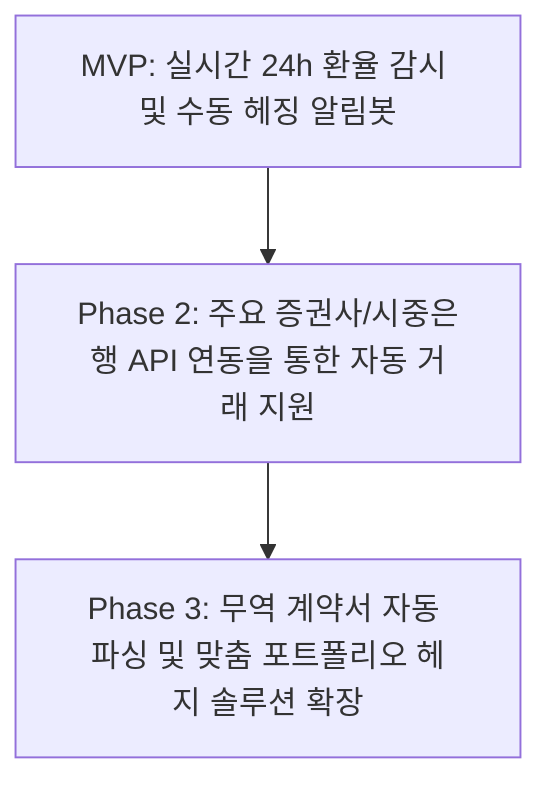

실행시간 : 2026-07-04_142224

# Forex24-Guard (포렉스24 가드): 24시간 외환시장 밀착형 SMB 수출입 자동 환헷징 관리 SaaS

## 1. 아이디어명
- **Forex24-Guard (포렉스24 가드)**: 중소기업(SMB)을 위한 24시간 밀착형 AI 자동 환헷징 및 최적 외환관리 통합 SaaS

## 2. 제안 범위 및 카테고리
- **대분류**: 소프트웨어 (Software)
- **중분류**: B2B SaaS (기업용 재무/FinTech 소프트웨어)

## 3. 해결 문제와 사용자 페르소나
- **해결하고자 하는 핵심 문제**:
  - 원-달러 환율이 1500원대라는 역대급 고환율 및 변동성 상황 속에서 7월 6일부터 외환거래가 24시간 체제로 전면 개방됨.
  - 전담 외환 딜러나 재무팀이 없는 중소 수출입 기업(SMB)들은 밤시간 대(야간 및 새벽) 해외 발 뉴스나 경제 지표 발표 등으로 발생하는 야간 외환 변동성에 완전히 노출됨.
  - 야간에 적시성 있는 헤징 거래나 환전 처리를 하지 못해 발생하는 환차손이 SMB의 순이익을 심각하게 갉아먹는 상황 발생.
- **사용자 페르소나**:
  - **김민수 (43세, 해외 IT 기기 및 정밀 부품 수입 유통사 대표)**: 연 매출 80억 원 수준의 SMB 경영자. 상시 달러 결제가 필요하나 원-달러 환율이 급격히 출렁일 때마다 결제 대금을 언제 환전해야 할지 밤잠을 설쳐가며 차트를 모니터링함. 전담 재무 담당자가 없어 자동화된 밤샘 리스크 관리 솔루션이 절실함.

## 4. 핵심 기능/차별점
- **24/7 실시간 환율 감시 및 AI 환율 변동성 예측 엔진**:
  - 외환시장 24시간 개방 API 및 글로벌 거시 지표 뉴스 데이터를 실시간으로 크롤링하여, 향후 3~6시간 내 환율 급변 가능성을 AI가 예측하고 즉각 푸시 알림 제공.
- **스마트 프리셋 기반 자동 환헤징(Auto-Hedging) 트리거**:
  - 사용자가 사전에 허용 가능한 최대 환손실 범위(예: 환율 1515원 돌파 시 자동 분할 헤지 실행)를 설정해 두면, 야간에도 은행/증권사 API와 연동해 통화선물 및 예약거래를 자동으로 체결해 주는 밤샘 가드 모드 가동.
- **수출입 계약 기반 '스마트 환율 룰' 매칭**:
  - 수출입 계약서 PDF를 업로드하면 납기일과 결제 주기를 분석하여 납기 시점별 최적의 헤지 비율과 계약 시점 환율을 자동 매칭해 주는 재무 비서 기능 제공.

## 5. 실행 계획 (MVP -> 확장)

- **MVP 단계**: 주요 통화 쌍(원-달러, 원-엔)의 24시간 실시간 시세와 알림 설정을 연동하여 환율 급변 시 슬랙(Slack), 카카오톡 알림을 즉시 발송하는 무료 모니터링 툴 출시.
- **Phase 2 (자동화)**: 시중은행의 24시간 외환 API 파트너십을 체결하고 사용자의 은행 계좌와 연동해 예약 주문을 자동으로 처리하는 라이선스 비즈니스 가동.
- **Phase 3 (포트폴리오 확장)**: 여러 수출입 계약을 다변화하여 관리하고 선물환, FX 마진 등 다양한 파생 상품 매칭을 지원하는 종합 엔터프라이즈 재무 관리(Treasury) 시스템으로 확장.

## 6. 수익 모델
- **구독 모델 (SaaS 구독료)**:
  - *Free Tier*: 실시간 환율 모니터링 및 기본 알림 (최대 3개).
  - *Standard Tier ($149/월)*: 자동 분할 헤지 설정 지원, 무역 계약서 연동 2개.
  - *Enterprise Tier ($499/월)*: 대규모 다자 통화 포트폴리오 관리, 무역 계약서 무제한, 전용 AI 리스크 리포트 발행.
- **거래 수수료 (Transaction Fee)**:
  - 제휴 은행/플랫폼을 통해 24시간 연동 거래가 일어날 시, 환전 및 헤지 거래 금액의 0.05%~0.1%를 파트너사로부터 리베이트 수취.

## 7. 일정/리소스 계획
- **개발 기간**: 총 4개월 (MVP 개발 2개월, 파트너 금융 API 밀착 연동 2개월)
- **필요 리소스**:
  - 풀스택 개발자 2명 (FinTech 연동 유경험자 필수)
  - 인공지능/데이터 분석가 1명 (시계열 모델 및 거시 지표 분석 개발)
  - UI/UX 디자이너 1명

## 8. 실현 가능성 점수 및 근거
- **실현 가능성 점수**: **4.6 / 5.0**
- **근거**:
  - 외환시장 24시간 전면 개방은 2026년 하반기 대한민국의 금융 인프라에서 가장 큰 제도적 변화 중 하나임.
  - 기존 대기업들은 고가의 전문 재무 시스템(ERP)과 외환 딜러를 두고 대처하지만 중소기업은 무방비로 방치되어 있어 시장의 수요가 매우 확고함.
  - 이미 정량적인 시계열 데이터가 존재하여 기술적 장벽이 낮고 규제 샌드박스를 통과할 시 폭발적인 선점 효과를 누릴 수 있음.

## 9. 참고 RSS FEED
- **참고 RSS FEED 제목**: [경제뭔데] 1년전 환율, 1300원대였는데···6일부터 24시간 외환거래 시작되면? - 경향신문
- **링크**: [URL](https://news.google.com/rss/articles/CBMiWkFVX3lxTE9uc2J1b2dMQV8xbm5Jc09IY1U5RHBFVHBEbTVPVXp2OWhwT1JZdUx2RGQwWlpjc1AyYjc4Y0NlYkw5VlppVlJobW5OMHc1RmN4dFdOaDBqTUV1QdIBX0FVX3lxTE1UN3VZLS1uUkVPSkNQQUVzWGNpbHhSVzJsUWdINzFXRlV1djBGQnEybzdmRFQxVFBZQ01GVEo0bkxBVV96d0kyWUc1SFdOUlNHeWFkM3lhbU9mQ0xneXR3?oc=5)
- **요약정보**: 외환위기 이후 28년 만에 환율이 분기 평균 1500원을 돌파하는 무서운 변동성을 겪는 가운데, 하반기 무역 거래를 지원할 24시간 외환시장 전면 개방 제도가 본격 시작됩니다. 실시간 야간 환리스크 제어가 중소기업들의 생존을 가르는 화두로 급부상했습니다.
