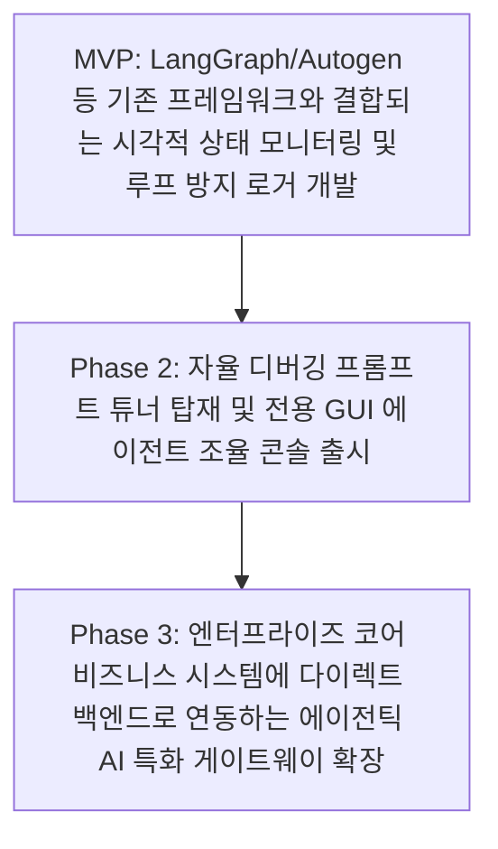

실행시간 : 2026-07-04_142231

# Orchestra-Agentic (오케스트라 에이전틱): 결정론적 안전 가드레일 내장 기업형 멀티에이전트 조율 MLOps 플랫폼

## 1. 아이디어명
- **Orchestra-Agentic (오케스트라 에이전틱)**: 신뢰성 보증 결정론적 상태 제어 기반 엔터프라이즈 멀티에이전트 통합 편대 조율 및 자율 디버깅 MLOps 솔루션

## 2. 제안 범위 및 카테고리
- **대분류**: 데이터 및 인공지능 (Data & AI)
- **중분류**: MLOps 및 에이전틱 AI 라이프사이클 관리 (MLOps / Agentic AI)

## 3. 해결 문제와 사용자 페르소나
- **해결하고자 하는 핵심 문제**:
  - 마크 저커버그 메타 CEO가 타운홀 미팅에서 "AI 에이전트 개발 속도가 예상보다 빠르지 않다"고 우려한 것처럼, 단일 생성형 AI 에이전트의 완전 자율 실행 방식은 심각한 신뢰성 결여(환각 동작, 논리 루프, 데이터 오처리) 문제를 야기함.
  - 단순한 'AI 에이전트(작업 실행기)' 단계를 극복하고 상호 유기적으로 협업하는 '에이전틱 AI(지능형 자율조율 시스템)'를 상용화하려면, 에이전트 간의 권한과 과업 실행 도메인을 엄격히 제어할 결정론적 규칙과 실시간 장애 복구 인프라가 필수적임.
  - 에이전트 편대가 스스로 목표를 세우고 동작할 때 발생하는 무한 프로세스 루프를 조기에 인지하고 자율적으로 프롬프트 및 파라미터를 교정(Self-Debugging)하는 특화된 개발 모니터링 체계가 없음.
- **사용자 페르소나**:
  - **정성우 (41세, 대형 물류 유통 그룹 AI 트랜스포메이션 리더)**: 고객 주문 처리부터 창고 자동 발주, 배송 라우팅까지 멀티 에이전트들을 활용해 지능형 시스템을 구축하고 싶어 함. 하지만 에이전트들이 복잡한 의사결정 분기에서 엉뚱한 결정을 내리거나 루프를 도는 등 신뢰성 에러가 잦아, 그룹 임원진에게 에이전틱 AI 솔루션을 100% 안심하고 납품할 수 있도록 통제하는 신뢰성 보증 MLOps 툴킷이 시급함.

## 4. 핵심 기능/차별점
- **결정론적 상태 머신(Deterministic State-Machine) 가드레일**:
  - 멀티 에이전트 간의 통신 시그널과 데이터 교환 경로를 시각적 상태 다이어그램으로 사전에 강제 락인(Lock-in)하여, 자율 에이전트가 허용되지 않은 보안 행동이나 프로세스를 완전히 탈피할 수 없도록 강제 샌드박싱 제어.
- **인플라이트 무한 루프 감지 및 오작동 자동 롤백 알고리즘**:
  - 상호 연쇄적인 협업을 진행하는 AI 에이전트들의 연산 지연, 쿼리 수렴 패턴을 감시하여 무한 반추(Thinking-Loop) 현상이 포착되면 실행을 일시정지하고, 최종 성공 상태로 데이터를 즉시 복원(Atomic-Rollback) 후 프롬프트를 보정해 재시도.
- **가상 도메인 특화 '에이전트 드라이런(Dry-Run)' 스트레스 테스트 엔진**:
  - 에이전틱 AI 시스템을 실제 운영 인프라에 배포하기 전에 수천 번의 가상 업무 시나리오(장애 상황, 악의적 무작위 사용자 입력 등)를 가동하여, 각 하위 에이전트들의 이탈 수치와 작업 성공 확률을 정량 레포트로 제공.

## 5. 실행 계획 (MVP -> 확장)

- **MVP 단계**: 널리 쓰이는 에이전트 라이브러리(LangGraph, CrewAI 등)의 중간 API 신호와 흐름을 추적하여 루프 발생 여부를 실시간 탐지하고 에러 로그를 Slack으로 쏴주는 플러그인 오픈소스 배포.
- **Phase 2 (시각 관제)**: 웹 브라우저 기반 GUI 환경에서 누구나 드래그 앤 드롭으로 에이전트들(기획 에이전트, 개발 에이전트, 감사 에이전트)의 작업 분기 규칙을 선언하고 상호 감시하게 만드는 에이전틱 웹 허브 플랫폼 구축.
- **Phase 3 (엔터프라이즈 탑재)**: 대형 금융, 핀테크, 커머스 기업 등의 실시간 주문/정산 코어 시스템과 연동하여 금융 거래 위험 부담 없이 자율 보장 거래를 실행하는 핵심 지능형 데이터 미드웨어로 안착.

## 6. 수익 모델
- **SaaS형 B2B 구독 모델**:
  - *Startup Tier ($299/월)*: 최대 5개의 자율 에이전트 오케스트레이션 지원, 에이전트 시뮬레이션 월 1,000회 지원.
  - *Professional Tier ($999/월)*: 최대 20개 에이전트 협업 제어, 실시간 무한 루프 감지 및 롤백 엔진 가동, 드라이런 가상 테스트 무제한.
  - *Enterprise Core (별도 견적 / 연 단위 계약)*: 온프레미스(사내 단독망) 배포 지원, 그룹 규정 컴플라이언스 룰셋 커스텀 연동 지원, 24/7 엔지니어 엔지니어링 케어 지원.

## 7. 일정/리소스 계획
- **개발 기간**: 총 5개월 (상태 제어 가드레일 엔진 설계 3개월, 루프 디텍터 및 롤백 라이브러리 개발 2개월)
- **필요 리소스**:
  - 에이전틱 AI 프레임워크(LangGraph, CrewAI 등) 기여 실적 보유 수석 엔지니어 1명
  - 시계열 상태 추적 알고리즘/수학 전공 데이터 사이언티스트 1명
  - GUI 인터랙티브 대시보드 프론트엔드 엔지니어 1명

## 8. 실현 가능성 점수 및 근거
- **실현 가능성 점수**: **4.7 / 5.0**
- **근거**:
  - 전 세계 테크 거인들(메타, 오픈AI 등)이 에이전틱 AI 시대로의 전환을 최우선 목표로 추진하고 있으나, 마크 저커버그조차도 실제 실무 적용 단계의 느린 진행과 안정성 한계를 명확하게 호소하고 있음.
  - 따라서, 단순히 '더 유연하고 똑똑한 에이전트'가 아닌 '엄격하고 안전하게 일 처리를 완수하는 통제 가드레일 MLOps'는 기업들이 비즈니스 다운타임과 오작동을 예방하기 위해 가장 먼저 확보하려는 최고의 무기이므로 시장 타겟이 매우 우수함.

## 9. 참고 RSS FEED
- **참고 RSS FEED 제목**: 에이전트 자율성 수준 / Mark Zuckerberg tells staff that AI agents haven’t progressed as quickly as he’d hoped
- **링크**: [링크 1](https://news.hada.io/topic?id=31115) / [링크 2](https://techcrunch.com/2026/07/02/mark-zuckerberg-tells-staff-that-ai-agents-havent-progressed-as-quickly-as-hed-hoped/)
- **요약정보**: 에이전틱 AI(Agentic AI) 패러다임이 대세를 이루고 있지만 실제 비즈니스 배포 현장에서는 잦은 실패와 자율성 조율의 부작용을 마주하고 있습니다. 저커버그 역시 AI 에이전트의 완성도 향상이 당초의 급진적인 직원 대체 예상보다 더뎌지고 있음을 전파하며, 안전하게 이들을 통제하고 복구하는 고차원 에이전틱 조율 프레임워크 솔루션의 절대적인 가치를 확인해 주었습니다.
