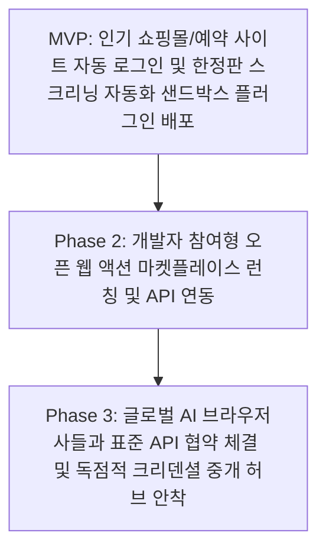

실행시간 : 2026-07-04_142231

# WebAgent-Marketplace (웹에이전트 마켓플레이스): 브라우저 대리인 탑재용 보안 샌드박스 웹 액션 레시피 매칭 마켓

## 1. 아이디어명
- **WebAgent-Marketplace (웹에이전트 마켓플레이스)**: 차세대 AI 브라우저 에이전트를 위한 검증된 웹 액션 레시피 및 실시간 보안 격리 크리덴셜 위임 중개 플랫폼

## 2. 제안 범위 및 카테고리
- **대분류**: 서비스 및 플랫폼 (IT Services)
- **중분류**: 마켓플레이스 (Platform / SaaS / AI-Brokerage)

## 3. 해결 문제와 사용자 페르소나
- **해결하고자 하는 핵심 문제**:
  - 구글 크롬, 사파리 등 글로벌 브라우저들의 전쟁이 단순 검색 정보 매칭에서 "사용자의 대리인이 되어 브라우저 내에서 무언가를 직접 수행하는 일(Action-oriented Web Agents)"로 변동됨.
  - 하지만 각 웹사이트(쿠팡, 에어비앤비, 인터파크 등)는 DOM 구조가 다르고 캡차(CAPTCHA) 등 보안 차단이 걸려 있어, AI 에이전트가 단독으로 완벽히 구매/예약을 완수하는 확률이 50% 미만임.
  - 또한, 유저의 민감한 결제 세션 키나 로그인 크리덴셜을 타사 AI 에이전트에 그대로 건네줄 경우 발생하는 무단 거래 및 데이터 갈취 리스크가 심각하여 사용자가 대리 구매를 포기함.
- **사용자 페르소나**:
  - **임하늘 (29세, 온라인 쇼핑 및 한정판 리셀러 테크 프리랜서)**: 콘서트 티켓팅, 한정판 슈즈 발매, 해외 직구 세일 등의 예약을 수시로 진행함. AI 브라우저 에이전트에게 예약과 결제를 안전하게 위임하고 싶지만, 내 신용카드 정보와 포털 세션 키가 유출될까 봐 불안함. 웹사이트별로 동작이 완벽히 검증되고 해킹 위협 없는 안전한 대리 브라우징 환경이 절실함.

## 4. 핵심 기능/차별점
- **검증된 '웹 액션 레시피(Verified Action Recipes)' 오픈 마켓**:
  - 유저 대신 항공권을 끊거나, 공공 서류를 다운받는 데 최적화된 웹 동작 제어 스크립트(Recipe)를 누구나 개발해 올리고, 안전도 검증 절차를 거쳐 AI 브라우저 플러그인에 납품하는 장터 구축.
- **가상 일회성 샌드박스 크리덴셜 볼트 (Disposable Session Sandbox)**:
  - 브라우저 에이전트가 타겟 사이트에 로그인할 때 유저의 원본 비밀번호 대신 암호화된 일회용 프록시 세션 토큰을 발급하여 거래를 처리하고, 지정된 단 한 건의 액션(예: 특정 항공편 예약 완료)이 마무리되면 즉시 격리 샌드박스를 폭파(Auto-Destruction).
- **캡차(CAPTCHA) 및 이상 동작 실시간 보정 게이트웨이**:
  - 에이전트가 웹서핑 도중 이미지 인증이나 봇 차단막을 마주치면 가상 샌드박스가 이를 중간 캡쳐하여 소유주(실제 유저)에게 원격 카톡 팝업을 전송, 유저가 수초 만에 인증 처리를 도우면 에이전트가 이어서 완수하는 휴먼-인-더-루프(Human-in-the-Loop) 보안 게이트 제공.

## 5. 실행 계획 (MVP -> 확장)

- **MVP 단계**: 구글 크롬 익스텐션 형태로 런칭하여 주요 직구 사이트나 티켓팅 사이트 3곳에 대해 유저가 세션만 넘겨주면 대신 모니터링 후 카톡으로 즉시 가이드하는 안전 세션 락커 베타 서비스 오픈.
- **Phase 2 (마켓화)**: 전 세계 웹 스크래핑 및 브라우저 자동화 개발자들이 각 사이트별 예약/접수 액션 레시피를 판매하고 수익을 배분받는 오픈 마켓 오픈(레시피별 일일 과금 정산).
- **Phase 3 (브라우저 제휴)**: 새롭게 출시되는 AI 온디바이스 브라우저 제조사들과 협업하여, 해당 브라우저들의 기본 탑재 기능에 WebAgent-Marketplace의 검증된 액션 모듈과 일회용 세션 분배기 API를 이식.

## 6. 수익 모델
- **웹 액션 중개 수수료**:
  - 예약, 구매 등 에이전트 대리 행동 한 건이 성공적으로 완료될 때마다 50원~500원의 결제 대리 중개 에스크로 수수료 수취.
- **레시피 마켓 판매 수수료 (App Store 수수료)**:
  - 프리미엄 액션 레시피(예: 글로벌 명품 직구 우회 결제 모듈 등) 판매 매출의 20%를 마켓플레이스 중개 플랫폼 수수료로 취득.
- **보안 보증 엔터프라이즈 API 정기 구독**:
  - 기업형 에이전틱 서비스 개발사를 위한 프리미엄 세션 볼트 가상 인프라 제공: 월 1,200달러부터.

## 7. 일정/리소스 계획
- **개발 기간**: 총 4개월 (일회용 가상 세션 샌드박스 핵심 코어 개발 2개월, 레시피 마켓 구축 2개월)
- **필요 리소스**:
  - 브라우저 엔진 인터널스 / 크롬 익스텐션 숙련 개발자 1명
  - 세션 하이재킹 및 데이터 암호화 전문 보안 엔지니어 1명
  - 플랫폼 결제/에스크로 백엔드 API 개발자 1명

## 8. 실현 가능성 점수 및 근거
- **실현 가능성 점수**: **4.3 / 5.0**
- **근거**:
  - 구글 크롬과 사파리를 위협하는 Arc, Arc Max 등 최신 브라우저 강자들이 대거 등장하는 '브라우저 2.0 기류'에서 핵심은 검색이 아니라 '행동 대행'임.
  - 브라우저를 통한 AI 대리 실행의 가장 큰 장애물은 보안 유출(해킹)과 DOM 가변에 따른 에러이므로, 이 둘을 중개·해결해 주는 샌드박스 레시피 마켓플레이스는 다가올 웹 에이전트 인프라에서 가장 완벽한 캐시카우 비즈니스로 안착할 것임.

## 9. 참고 RSS FEED
- **참고 RSS FEED 제목**: The browser wars aren’t about search anymore — here are the best alternatives to Chrome and Safari
- **링크**: [링크](https://techcrunch.com/2026/07/03/as-the-browser-wars-heat-up-here-are-the-hottest-alternatives-to-chrome-and-safari-in-2026/)
- **요약정보**: 브라우저 전쟁이 사용자를 대리하여 복잡한 인터넷 예약과 액션을 완수하는 AI 브라우저 에이전트 시장으로 격변했습니다. 안전하게 유저의 크리덴셜 세션을 가두고 작동을 검증해 줄 전문 중개 플랫폼 및 사이트별 실행 자동화 시나리오 마켓플레이스 수요가 폭발적으로 개화하는 배경입니다.
