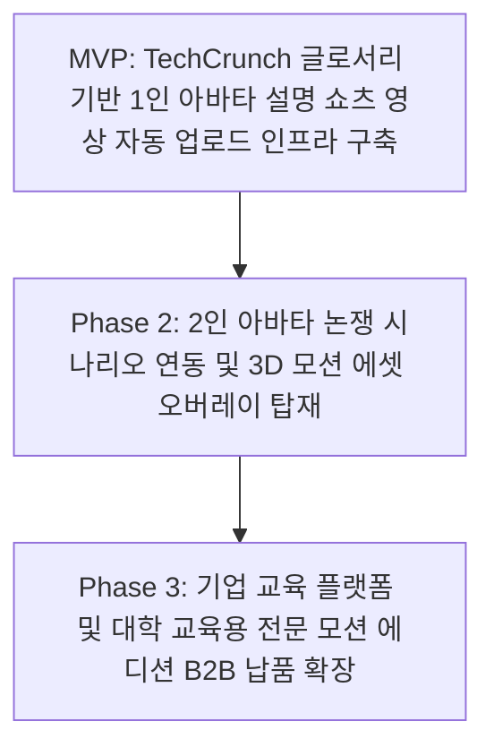

실행시간 : 2026-07-04_142231

# TechGloss-Show (테크글로스 쇼): 최신 테크 및 AI 용어 완전 정복 인터랙티브 모션 애니메이션 쇼러너

## 1. 아이디어명
- **TechGloss-Show (테크글로스 쇼)**: 최신 테크 및 생성형 AI 전문 용어 자동 정제 및 3D 모션 그래픽 해설 버추얼 쇼러너

## 2. 제안 범위 및 카테고리
- **대분류**: 유튜브 콘텐츠 및 미디어 (YouTube & Media)
- **중분류**: AI 자동화 채널 및 시청자 반응형 콘텐츠 분석 (AI Automation & Interactive Contents)

## 3. 해결 문제와 사용자 페르소나
- **해결하고자 하는 핵심 문제**:
  - LLM, RAG, RLHF, DPO, Agentic AI 등 매주 새롭게 발표되는 고난도 AI 개념과 기술 용어들의 범람으로 기획자, 투자자, 실무자들의 지식 병목과 소외감이 심화됨.
  - 기존의 IT 지식 해설 영상들은 지나치게 긴 러닝타임으로 집중을 방해하거나 지루한 슬라이드식 캡처 중심이어서 시각적 매력이 떨어지고 전파 속도가 매우 더딤.
  - 매일 쏟아지는 트렌드 용어를 매번 작가가 직접 찾아 각색하고 3D 디자이너가 인포그래픽을 수동 제작해 올리는 워크플로우는 영상 업로드 주기를 늦추며 제작 예산(연간 수천만 원) 낭비로 귀결됨.
- **사용자 페르소나**:
  - **강태오 (28세, 테크 스타트업 신입 주니어 기획자)**: 개발팀과의 아키텍처 기획 회의에 들어갈 때마다 쏟아지는 최신 AI 용어(예: 임베딩, 오케스트레이션 등)를 제대로 알지 못해 어지러움을 느낌. 네이버 검색이나 딱딱한 사전 문구 대신 매일 출퇴근 시간에 1분 미만의 트렌디한 3D 모션 쇼츠 영상으로 단숨에 개념을 재미있게 정복하고 싶음.

## 4. 핵심 기능/차별점
- **글로벌 IT 뉴스 글로서리 자동 추출 시나리오 생성기**:
  - 테크크런치(TechCrunch) 등 실시간 테크 저널의 신종 유행 테크 키워드를 즉시 수집하고, 이를 "유치원생도 한 번에 이해하는 고도의 비유와 스토리라인"으로 가공하여 스페셜 숏폼 대본을 자동 렌더링.
- **가상 AI 대변인 아바타 간의 '논쟁형' 다이얼로그 연출**:
  - 일방적인 주입식 설명에서 탈피하여, 장난기 넘치고 의심 많은 아바타와 뇌과학 전공 수재 아바타 간의 티키타카(Tiki-Taka)식 논쟁 구조를 통해 개념을 아주 유쾌하게 소화.
- **WebGL 및 모션 템플릿 연동 직관적 그래픽 렌더러**:
  - 설명 대상 기술의 구조(예: 신경망 배선, RAG 검색 순서 등)를 가상 캔버스의 고해상도 3D 인터랙티브 그래픽 에셋으로 실시간 구동하고, 아바타의 손짓과 대화 타이밍에 오차 없이 맞춤 자막과 자이로 효과를 얹어 고화질 영상으로 완성.
- **시청자 참여형 '용어 신청 및 투표' 오토-러너 연동**:
  - 유튜브 라이브나 고정 댓글을 통해 "다음 편에 설명해 줬으면 하는 용어"를 주관식 신청받고, 투표 수에 비례하여 시스템이 자동으로 다음 날 방송 각본과 그래픽을 우선 생성하여 업로드하는 참여 유도 루프 가동.

## 5. 실행 계획 (MVP -> 확장)

- **MVP 단계**: 매일 해외 테크 저널에서 가장 핫한 AI 키워드를 1개씩 선정하고, 고품질 보이스 오버와 자동 자막이 입혀진 60초 요약 쇼츠 영상을 인스타그램, 유튜브, 틱톡에 정기 자동 발행하는 모니터봇 채널 가동.
- **Phase 2 (비주얼 격상)**: 전문 3D 모션 애니메이션 툴 API를 연동하여 'RAG 설명' 시 실제로 벡터 공간에서 데이터를 매칭해 보여주는 직관적인 비주얼 매력도 격상.
- **Phase 3 (B2B 기업 교육)**: 테크 대기업 임직원이나 공학 대학 교육용 가상 테크 교과서 연동 소프트웨어(B2B SaaS) 및 교육 자료 자동 번역 패키지 패키징 판매.

## 6. 수익 모델
- **유튜브 애드센스 광고 및 채널 프리미엄 멤버십**:
  - 채널 프리미엄 멤버($4.99/월) 가입 시 '미공개 상세 테크 리포트 PDF' 다운로드 서비스 제공 및 실시간 라이브 투표 가중권 부여.
- **테크 채널 전용 B2B 협찬 홍보 마켓**:
  - 새로운 AI 소프트웨어를 개발한 스타트업들이 자사의 툴이나 오픈소스 라이브러리를 용어 사전에 등록하고, 이를 버추얼 쇼를 통해 자연스럽게 PPL처럼 소개하는 스폰서십 광고 수주 (편당 3,000달러~10,000달러).
- **기업 맞춤형 커스텀 사내용 테크 글로서리 비디오 제작 대행 라이선스**:
  - 연간 기업 구독 라이선스: 사내 맞춤용 버추얼 인프라 교육 비디오 자동 생성 솔루션 연 25,000달러.

## 7. 일정/리소스 계획
- **개발 기간**: 총 4개월 (생성 비디오 자동화 파이프라인 개발 2개월, 시큐어 및 투표 데이터 수집 엔진 2개월)
- **필요 리소스**:
  - AI 그래픽스 / 영상 자동 합성 모션 디자이너 1명
  - LLM 대화 시나리오 구조화 백엔드 엔지니어 1명
  - 채널 마케팅/시청 반응형 분석 마스터 1명

## 8. 실현 가능성 점수 및 근거
- **실현 가능성 점수**: **4.5 / 5.0**
- **근거**:
  - 생성형 AI 열풍으로 전 세계적으로 배움에 갈증을 느끼는 인구가 역대급으로 팽창한 반면, 최신 소식들은 대부분 영어나 난해한 수학 수식의 전유물로만 도배되어 대중 친화적인 인터랙티브 시각화 매체의 가치는 천문학적인 조회를 얻음.
  - 검증된 테크 저널의 소스를 즉각 가공하므로 기획 및 디자인 공수가 최소화되고, 시청자 반응형 투표와 실시간 모션 렌더링으로 어텐션 홀딩과 채널 충성도가 대단히 극대화될 수 있어 매우 높은 확률로 성공 가능함.

## 9. 참고 RSS FEED
- **참고 RSS FEED 제목**: The only AI glossary you’ll need this year
- **링크**: [링크](https://techcrunch.com/2026/07/03/artificial-intelligence-definition-glossary-hallucinations-guide-to-common-ai-terms/)
- **요약정보**: 테크크런치에서 발행한 AI 글로서리 바이블은 복잡한 생성형 인공지능 용어들을 비전문가들도 쉽게 이해할 수 있는 쉬운 단어로 해설하여 격찬을 받았습니다. 이러한 양질의 요약 팩트를 시청자들이 매일 1분 숏폼의 화려한 3D 모션 그래픽과 가상 아바타 쇼를 통해 재미있게 흡수할 수 있는 미디어 비즈니스 수요를 강력하게 뒤받쳐 줍니다.
