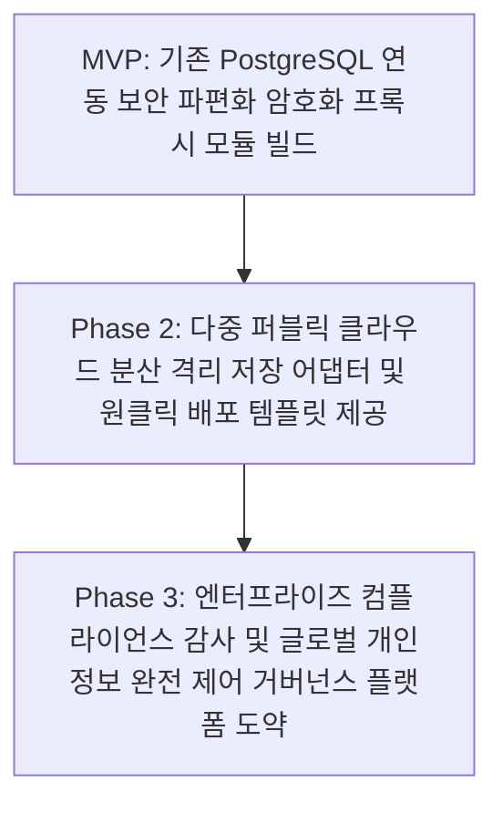

실행시간 : 2026-07-04_142231

# DecentShield-DB (디센트쉴드 DB): 분산 수집형 국가 감시 방지 제로트러스트 데이터 최소화 DB 프록시

## 1. 아이디어명
- **DecentShield-DB (디센트쉴드 DB)**: 국가/대기업 통합 감시 방지용 제로트러스트 개인정보 물리 파편화 DB 프록시 보안 SaaS

## 2. 제안 범위 및 카테고리
- **대분류**: 소프트웨어 (Software)
- **중분류**: 보안 및 개인정보 제로트러스트 데이터 솔루션 (Cybersecurity)

## 3. 해결 문제와 사용자 페르소나
- **해결하고자 하는 핵심 문제**:
  - 정부나 빅테크 기업들이 법규나 편의성을 명분으로 흩어져 있던 시민의 모든 라이프 데이터(의료, 과세, 자산, 동선 등)를 한곳으로 무단 연동 및 통합하려 함.
  - 분산 저장이라는 최후의 보안 방어선마저 무너지며 시민 전체에 대한 영구적인 프로파일링과 감시 시스템 구축 리스크 급부상.
  - 현대 법적 컴플라이언스(GDPR 등)는 "데이터 수집 최소화"를 강하게 권고하지만, 개발자들은 어떻게 분산 인프라를 안전하게 개발하고 다자 감사 로그를 남겨야 할지 구체적인 아키텍처 가이드가 부재함.
- **사용자 페르소나**:
  - **오동현 (35세, 핀테크 및 이커머스 스타트업 최고기술책임자 CTO)**: 개인 금융 거래 정보와 실생활 취향 로그를 수집·관리하는 플랫폼 총괄 개발자. 신규 보안 컴플라이언스와 감사 로그, 데이터 최소화 수집 원칙을 완벽히 구현하라는 정부 권고를 받았으나, 기존의 통합 DB(MySQL, PostgreSQL 등) 설계로는 데이터를 완전히 안전하게 분할 저장하면서 유저 매칭 서비스를 매끄럽게 처리하기가 무척 어려워 솔루션을 원함.

## 4. 핵심 기능/차별점
- **무조건적 데이터 파편화(Sharding-and-Shield) 엔진**:
  - 유저의 핵심 프로필 데이터(예: 이메일, 의료 식별번호 등)가 DB에 직접 평문 기록되는 것을 원천 배제하고, 수집 즉시 난독 토큰화하여 물리적/지리적으로 완벽히 격리된 다중 클라우드 가상 사설망(VPC) DB에 독립적인 조각으로 저장.
- **다자간 암호화 동적 쿼리 매칭 (Secure Multiparty Computation Proxy)**:
  - 서비스를 위해 데이터 조회가 반드시 필요한 순간에만, 유저가 제공한 일회용 세션 키 및 프록시를 통해 즉석에서 파편화된 데이터들을 가상 메모리 상에 끌어올려 합친 뒤 평문 노출 없이 결과만 연산·제공 후 휘발 처리.
- **불변 분산 원장 기반 접근 감사(Audit) 로그 장부**:
  - 어떤 개발자나 관리자, 혹은 외부 침입자가 유저의 데이터를 강제 열람하려 할 시 모든 접근 쿼리와 이력을 위변조가 차단된 감사 원장에 영구 보관하여 무단 개인 식별 행위를 정량적으로 즉시 고발 및 무력화.

## 5. 실행 계획 (MVP -> 확장)

- **MVP 단계**: 널리 사용되는 오픈소스 데이터베이스(PostgreSQL, MongoDB) 앞에 중간 중개 서버(Proxy Docker) 형태로 연동하여, 지정된 민감 열(Column)들을 자동으로 일방향 해시 및 파편화 배분해 주는 경량 SDK 릴리즈.
- **Phase 2 (멀티인프라화)**: AWS, GCP, Azure, Oracle Cloud 등 다변화된 인프라 망을 활용하여 실제 물리적인 주권 국가 단위까지 분할해 보관하는 프라이버시 전용 호스팅 파트너십 구축.
- **Phase 3 (거버넌스 통합)**: 기업의 정보 보호 책임자(CISO)를 위한 보안 실시간 준수 현황 인터랙티브 대시보드와 국가 정보보안 인증(ISMS-P) 대응 컴플라이언스 자동 생성 기능 통합.

## 6. 수익 모델
- **인프라 사용 기반 종량 요금제 및 SaaS 구독형**:
  - *Developer Tier*: 무료 (로컬 단일 DB 파편화 모듈 제공, 소규모 개발용).
  - *Standard Shield ($249/월)*: 다중 인프라 2개 망 격리 저장, 실시간 불변 접근 로그 월 10만 건 지원.
  - *Enterprise Core (상담 협의 / 월 1,500달러~)*: 지리적 멀티 클라우드 분산망 4개 이상 지원, 실시간 컴플라이언스 오디팅 툴 연동, 제로트러스트 전용 기술 전담 매칭 가이드.

## 7. 일정/리소스 계획
- **개발 기간**: 총 4개월 (프록시 쿼리 합성 인터셉터 엔진 2개월, 멀티 클라우드 격리 수집 어댑터 2개월)
- **필요 리소스**:
  - 제로트러스트 / 데이터베이스 인터널스 보안 전문가 1명
  - 클라우드 아키텍트/DevSecOps 인프라 엔지니어 1명
  - 코어 백엔드 개발자 1명

## 8. 실현 가능성 점수 및 근거
- **실현 가능성 점수**: **4.4 / 5.0**
- **근거**:
  - 미국 정부의 통합 감시 DB 시도와 글로벌 개인정보 유출 참사가 이어지면서 "개인정보 수집 및 저장 최소화"와 "분산 설계"는 더 이상 선택이 아닌 필수 보안 의무(GDPR, CCPA 등)로 대두함.
  - 기존 인프라 코드를 뜯어고칠 필요 없이 DB 전면 프록시 교체 형태로만 도입하여 즉각적인 국가 감시 방지 등 강력한 컴플라이언스 규격 승인을 보증하므로 엔터프라이즈 B2B 시장의 지출 의향이 매우 강력함.

## 9. 참고 RSS FEED
- **참고 RSS FEED 제목**: 미국의 개인정보 비상사태
- **링크**: [링크](https://news.hada.io/topic?id=31116)
- **요약정보**: 세계적인 양자컴퓨터 권위자 스콧 애런슨은 미국 국가 정보망이 시민들의 모든 라이프 개인정보를 단일 중앙 DB망에 통합하는 거대한 전 국민 감시 프로젝트를 진행하고 있음을 경고했습니다. 물리적 분산 방어선이 깨진 시대에서 개발자들은 설계 단계부터 감시를 무력화할 제로트러스트 데이터 파편화 및 접근 감사 로그 시스템을 구현해야 합니다.
