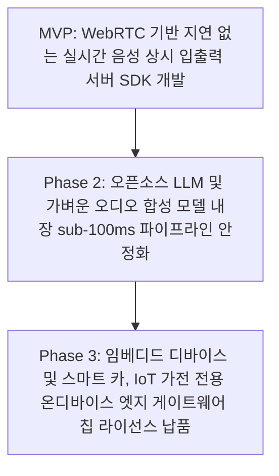

실행시간 : 2026-07-04_142239

# WhisperEdge-Voice (위스퍼엣지 보이스): 실시간 WebRTC 연동 sub-100ms 대화형 보이스 에이전트 인플라이트 게이트웨이

## 1. 아이디어명
- **WhisperEdge-Voice (위스퍼엣지 보이스)**: 9억 사용자 스케일 보증 실시간 WebRTC 프로토콜 기반 sub-100ms 초저지연 보이스 AI 전송 가속 엣지 게이트웨이

## 2. 제안 범위 및 카테고리
- **대분류**: 데이터 및 인공지능 (Data & AI)
- **중분류**: 실시간 음성 에이전트 데이터 파이프라인 가속 (LLM Apps / Edge Computing)

## 3. 해결 문제와 사용자 페르소나
- **해결하고자 하는 핵심 문제**:
  - 기존 보이스 AI 서비스는 사용자가 말을 마칠 때까지 침묵하고 기다렸다가 [STT 변환 -> LLM 연산 -> TTS 합성 -> 오디오 파일 다운로드]의 정형화된 폭포수 방식을 거쳐 응답이 1~2초 뒤에 나옴.
  - 이로 인해 대화에 심각한 단절이 생기고, 상대방의 말을 중간에 끊는(Interruption) 극도로 인간다운 소통 흐름을 완벽히 소화할 수 없음.
  - 오픈AI가 Voice AI를 9억 명 유저에게 배포하면서 입증한 sub-100ms 초저지연 오디오 패킷 엣지 렌더링, WebRTC의 양방향 미디어 파이프라인 가속을 일반 중소 AI 플랫폼이나 IoT 기업들은 자력으로 구현해 탑재하기 어려움.
- **사용자 페르소나**:
  - **한지수 (34세, 원격 소아 청소년 심리 전문 AI 상담 서비스 개발팀장)**: 아이들이 실시간으로 음성 AI 아바타와 대화를 나누며 멘탈 케어를 받는 앱을 운영 중임. 상담의 자연스러운 흐름을 위해 레이턴시 최소화가 생명이나, 클라우드 서버와의 연동 단계에서 잦은 전송 끊김과 1.5초 이상의 대화 어색함으로 아이들이 대리 상담 중 집중을 금방 잃어버리는 병목에 직면함.

## 4. 핵심 기능/차별점
- **WebRTC 양방향 다이렉트 미디어 스트림 터널링**:
  - 기존의 단방향 HTTP 청크 업로드 구조를 전면 대체하고, WebRTC 미디어 채널을 백엔드 AI 모델과 다이렉트로 결합하여 오디오 수집과 렌더링이 중단 없이(In-flight Streaming) 상시 왕복되도록 설계.
- **오디오 패킷 '마이크로-청크(Micro-Chunking)' 병렬 디코더**:
  - 음성 데이터를 단 20ms 미만의 미세 프레임(Micro-Frame) 단위로 쪼개어 STT와 가볍게 동치(On-the-fly Tokenization)시키고, LLM에서 토큰이 생성되는 족족 Handoff TTS를 작동시켜 청각적 반응 지연을 완전히 무력화.
- **지능형 사용자 '끼어들기(Interruption)' 실시간 중단 게이트**:
  - AI가 열심히 목소리를 합성해 유저의 스피커로 출력하는 중간이라도, 유저의 마이크 마우스피스로부터 새로운 유효 음성 주파수(Voice Activity Detection)가 감지되는 즉시, 엣지 게이트웨이가 즉각 기존 출력 패킷 송출을 차단(Mute)하고 신규 쿼리 컨텍스트를 LLM에 전달해 매끄러운 끊기를 보증.

## 5. 실행 계획 (MVP -> 확장)

- **MVP 단계**: 개발자가 즉시 자사 웹/앱에 임포트해 쓸 수 있는 WebRTC 기반 양방향 오디오 파이프라인 SDK 릴리즈 (간단한 OpenAI Whisper / TTS 모델과의 레이턴시 동기화 성능 보증 패키지 포함).
- **Phase 2 (경량화)**: 엣지 컴퓨팅 기반으로 가상 음성 인코더 가속 드라이버를 탑재하여 클라우드 서버를 거치지 않고 사용자 단말기 브라우저 내부에서 다이렉트로 실시간 음성 패치 캐싱이 작동되도록 컴파일 고도화.
- **Phase 3 (IoT 확장)**: 자동차 전장 시스템(현대/기아 카인포테인먼트 등) 및 스마트 홈 IoT 냉장고, 가전 제조사와 전용 음성 AI 엣지 게이트웨이 커스텀 라이선스 대형 수주 계약 체결.

## 6. 수익 모델
- **네트워크 오디오 대역폭 및 트래픽 연동 요금제**:
  - 무료: 월 음성 상담 100분, 기본 레이턴시 500ms 지원.
  - *Ultra Low Latency Tier ($199/월)*: 월 10,000분 음성 상담, 지연시간 sub-150ms 보장, 동시 대화 끼어들기 감지 컴포넌트 풀 탑재.
  - *Scale Tier ($899/월)*: 월 50,000분, sub-100ms 초저지연 보장, 하이브리드 클라우드 전용 엣지 게이트웨이 단독망 할당.

## 7. 일정/리소스 계획
- **개발 기간**: 총 5개월 (WebRTC 백엔드 터널러 코어 설계 3개월, 초미세 청킹 및 끼어들기 차단 알고리즘 2개월)
- **필요 리소스**:
  - WebRTC / SIP 실시간 미디어 스트리밍 통신 시니어 엔지니어 1명
  - 오디오 가속 드라이버 / DSP(Digital Signal Processing) 전문 개발자 1명
  - 파이프라인 전송 분배 클라우드 엔지니어 1명

## 8. 실현 가능성 점수 및 근거
- **실현 가능성 점수**: **4.8 / 5.0**
- **근거**:
  - OpenAI가 9억 유저를 상대로 초저지연 실시간 양방향 음성 가속 아키텍처 배포를 이미 완수하여 음성 UI(VUI) 시장의 대폭발을 일으킨 기술적, 상업적 대선례가 완벽함.
  - 기존의 명상 앱, 심리 상담, 외국어 튜터링, 메타버스 캐릭터, 자율주행 차 인포테인먼트 등 "말귀를 알아듣는 저지연 음성 AI 엔진"의 도입을 원치 않는 곳이 없을 정도이며, 백엔드 게이트웨이 라이브러리 교체만으로 sub-100ms 반응을 즉시 뿜어내므로 구매 당위성이 절대적임.

## 9. 참고 RSS FEED
- **참고 RSS FEED 제목**: How OpenAI Delivers Low-Latency Voice AI for 900M Users
- **링크**: [링크](https://blog.bytebytego.com/p/how-openai-delivers-low-latency-voice)
- **요약정보**: OpenAI가 9억 글로벌 시청자의 격렬한 동시 다발 트래픽 속에서도 레이턴시 없이 끊김 없고 극도의 생생한 실시간 양방향 음성 AI를 구현해 전송한 고차원 가속 파이프라인 아키텍처 분해 레포트입니다. 모든 보이스 AI 및 지능형 엣지 헬스케어, 스마트 가구 비즈니스의 무조건적인 핵심 마스터 키 기술입니다.
