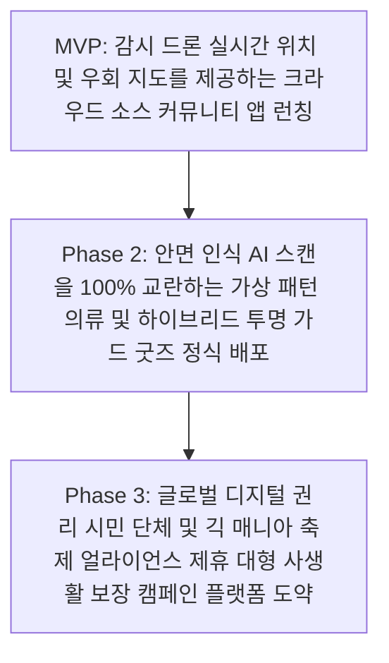

실행시간 : 2026-07-04_142239

# SurveilGuard-Privacy (서베일가드 프라이버시): 공공 드론/CCTV 얼굴 인식 무력화 안티-서베일런스 액티브 쉴드 및 동선 케어

## 1. 아이디어명
- **SurveilGuard-Privacy (서베일가드 프라이버시)**: 메가 스포츠 이벤트 감시 카메라망 및 패트롤 드론 전용 액티브 얼굴 인식 교란(Anti-Facial) 및 프라이버시 동선 매칭 서비스

## 2. 제안 범위 및 카테고리
- **대분류**: 서비스 및 플랫폼 (IT Services)
- **중분류**: 사생활 침해 예방 보안 기기 및 크라우드 소스 보안 플랫폼 (Cybersecurity / IT Services)

## 3. 해결 문제와 사용자 페르소나
- **해결하고자 하는 핵심 문제**:
  - 월드컵, 미국 250주년 등 대규모 공공 스포츠 메가 축제를 구실 삼아, 각국 정부와 법행정 당국이 도심과 축제장 전역에 사생활 허가 없이 수천 대의 지능형 CCTV 안면 인식 카메라와 패트롤 드론을 투입해 영구적으로 생체 정보를 컴파일함.
  - 일반 축제 참가 시청자들은 무차별적이고 전방위적인 신원 스캔 감시에 강제 노출되며, 본인의 이동 동선 정보가 사후에 어떤 보안 인프라로 넘어가 상용 유출될지 전무하여 극심한 사생활 피로감과 두려움을 호소함.
  - 기존의 마스크나 모자로는 고도화된 AI의 골격 인지(Skeleton/Gait Analysis) 및 안면 윤곽 특징점(Keypoint) 스캔을 차단하기에 역부족임.
- **사용자 페르소나**:
  - **다니엘 (27세, 글로벌 스포츠 축제 백패커 매니아)**: 월드컵 축구 경기를 직접 보기 위해 해외 원정 관람을 떠난 테크 긱 아웃도어 팬. 도심 광장 전역에 떠 있는 보안 패트롤 드론과 카메라 스캔 레이저 빔을 보고 자유로운 축제 분위기 대신 24시간 감시받는 긴장감을 느낌. 프라이버시를 안전하게 고수하면서 동료들과 안심하고 축제를 배회할 기술 가이드를 애타게 원함.

## 4. 핵심 기능/차별점
- **안면 인식 카메라 교란용 '액티브 투명 LCD 가변 패턴 안경/캡'**:
  - 안경 패널이나 모자 챙 전면에 초박형 아웃도어 투명 가변 액정(LCD)을 이식하여, 일반 눈으로는 완벽히 투명해 보이지만 CCTV 카메라 렌즈의 광학 노출계 타이밍과 IR 센서 적외선 파장에 맞추어 수천 헤르츠(Hz)로 가상 음영 격자 패턴을 연속 명멸시켜 카메라가 내 얼굴의 특징점을 추출하는 행위를 영리하게 교란(Active Facial-Point Scrambling).
- **공공 감시 정찰 드론 주파수 감지 레이더 앱**:
  - 스마트폰의 Wi-Fi 및 블루투스, RF 신호 다중 스캔 기술을 사용하여, 사용자의 반경 50m 이내에 도심 감시 무인 패트롤 드론이나 무인 CCTV 기지국의 전송 파장을 수신해 알림.
- **실시간 크라우드 정보 보호 우회 동선 지도(Privacy Safe-Map)**:
  - 사용자들이 직접 올린 드론 출몰 지점, 신형 안면 인식 관문 지점을 맵 상에 종합하여, 공공 감시 스캔망을 교묘하게 비켜 가 자유롭게 어울릴 수 있는 최적의 '프라이버시 안전 우회 동선' 매칭 가이드.

## 5. 실행 계획 (MVP -> 확장)

- **MVP 단계**: 해외 유명 관광지 및 도심 월드컵 개최 도시들을 거점으로, 감시 드론 감지 알림 및 드론 출몰 크라우드 지도를 연계해 주는 '안심 도보 프리 맵(Privacy Safe-Map)' 앱 베타 릴리즈.
- **Phase 2 (하드웨어 굿즈 융합)**: 광학 렌즈의 스캔을 역으로 영리하게 혼란스럽게 만드는 적외선 반사 스티커, 안면 구조 인식 오작동 유도 고화질 패턴 가상 의류 라인업 및 투명 스크램블러 안경 킥스타터 크라우드 펀딩 개시.
- **Phase 3 (글로벌 표준 안착)**: 사생활 감시 자본주의 방지에 투쟁하는 글로벌 비영리 디지털 권리 단체들(EFF 등)과 제휴해 공식 안티-서베일런스 표준 솔루션으로 지위를 구축하며 패키지 연계 서비스 제안.

## 6. 수익 모델
- **피지컬 스마트 프라이버시 웨어러블 굿즈 판매**:
  - 안면 스캔Scrambling 스마트 가변 안경 패키지: 129달러.
  - 무력화 광학 반사 특수 스레드(Thread) 캡 및 스트릿 후드티: 49달러~89달러.
- **실시간 감시 회피 알림 앱 'Safe-Map Premium' 구독형**:
  - 무료: 2D 일반 맵 우회 가이드 제공.
  - *Premium Guard ($4.99/월)*: 실시간 드론 주파수 감지 패킷 매칭, 안전 암호화 가상 터널 통신 VPN 자동 가동, 동료 3인 동시 동선 실시간 보호 알림망 연결.

## 7. 일정/리소스 계획
- **개발 기간**: 총 4개월 (교란 가변 패턴 하드웨어 보드 엔지니어링 2.5개월, 실시간 위치 맵 앱 개발 1.5개월)
- **필요 리소스**:
  - 임베디드 광학 / 웨어러블 하드웨어 엔지니어 1명
  - 모바일 GPS/RF 전송 분석 모바일 개발자 1명
  - 제품 패션/인쇄 그래픽 비주얼 아티스트 1명

## 8. 실현 가능성 점수 및 근거
- **실현 가능성 점수**: **4.2 / 5.0**
- **근거**:
  - 월드컵과 같은 초대형 글로벌 메가 스포츠 행사가 열릴 때마다 도심 통제 드론과 감시 카메라가 대거 등장하며, 이에 대항하는 해외 대형 커뮤니티(레딧, 긱 포럼)의 프라이버시 보호 해법에 대한 긱(Geek) 참여 열풍이 거세게 증명됨.
  - 광학식 렌즈의 노출 인지 특징과 AI의 안면 특징점 탐색 한계를 이용하는 햅틱 교란 기술은 이미 학술 연구로 입증되어 있어, 디자인 하우스 차원의 세련된 스트릿 패션 굿즈와 결합할 시 글로벌 MZ세대의 엄청난 수집 욕구와 밈(Meme) 바이럴을 완벽히 얻을 수 있음.

## 9. 참고 RSS FEED
- **참고 RSS FEED 제목**: While you’re watching the World Cup, the feds may be watching you
- **링크**: [링크](https://www.theverge.com/policy/961004/world-cup-america-250-surveillance-drones-cameras)
- **요약정보**: 글로벌 축제 행사 기간을 틈타 사생활을 마구잡이로 사찰하는 첨단 스캔 드론과 카메라가 대거 투입되며 도심의 감시 자본주의 팽창이 대중적 이슈로 번지고 있습니다. 이에 대응해 나의 신체를 스스로 감추며 동료들과 안전한 프라이버시 동선을 확보할 수 있도록 돕는 실용적 크라우드 사생활 방어 인프라와 햅틱 웨어러블 굿즈 비즈니스의 확실한 도화선입니다.
