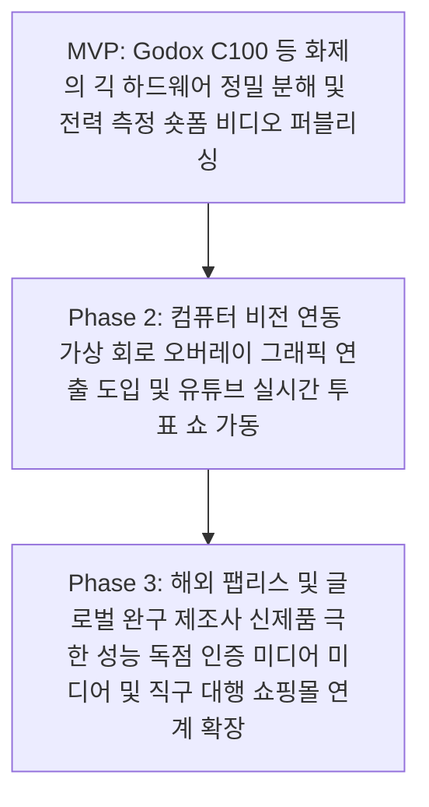

실행시간 : 2026-07-04_142239

# TechInspect-Show (테크인스펙트 쇼): 투명 인터랙티브 오버레이 그래픽 결합 하드웨어 극한 검증 리스너 채널

## 1. 아이디어명
- **TechInspect-Show (테크인스펙트 쇼)**: 투명 인터랙티브 오버레이 그래픽 결합 실물 테크 기기 분해 및 크라우드 지시형 하드웨어 검증 스트리밍 쇼

## 2. 제안 범위 및 카테고리
- **대분류**: 유튜브 콘텐츠 및 미디어 (YouTube & Media)
- **중분류**: 인터랙티브 비디오 및 시청자 참여 라이브 커머스 (Interactive Media / YT Stream)

## 3. 해결 문제와 사용자 페르소나
- **해결하고자 하는 핵심 문제**:
  - 고독스 C100 투명 뷰파인더 카메라, 가성비 태블릿 등 독특하고 복고적이며 트렌디한 전자 하드웨어 장난감들이 다수 발매되고 있지만, 시중의 언박싱 및 가벼운 개봉기 채널들은 기기 외형과 기본 매뉴얼만 보여주어 차별성이 떨어짐.
  - 소비자는 "진짜 4GB 램 업그레이드로 인한 게임 속도 변화가 유의미한가?", "투명 뷰파인더 LCD 내부 센서 회로는 어떤 구조로 전류를 측정하는가?" 등 전문적이고 깊이 있는 분해나 실질적인 극한 성능 한계 테스트의 대리 만족을 강력하게 체험하고 싶어 함.
  - 고도의 3D 내부 투사 그래픽 연출을 일반 1인 미디어가 매번 수동 제작하려면, 엄청난 애프터 이펙트 수동 그래픽 합성 공수와 긴 영상 렌더링 지연으로 채널 성장의 황금 시기를 놓쳐 버림.
- **사용자 페르소나**:
  - **민경훈 (24세, 전자공학 대학생 및 하드웨어 얼리어댑터)**: 새로운 아날로그 컨셉의 고독스 카메라나 초소형 태블릿 마이너 체인지 버전이 나올 때마다 호기심에 밤새 긱 포럼을 구경함. 기기 구조를 훤히 보여주는 가상 회로 오버레이 그래픽 연출과 시청자들이 실시간 투표로 정하는 기상천외한 물리 테스트(예: 침수 후 건조, 충격 가하기 등)를 유쾌하게 실행해 주는 참여형 테크 쇼 채널의 열렬한 구독자를 꿈꿈.

## 4. 핵심 기능/차별점
- **투명 레이어 컨셉 인터랙티브 CG 오버레이**:
  - 카메라 전면에 투명 LCD 컨셉 오버레이 그래픽 기법을 입혀, 실물 하드웨어 제품을 카메라에 비추면 AI 컴퓨터 비전이 제품의 분해 단면(CAD)과 회로 배치, 소모 전력 흐름도를 가상의 홀로그램 형태로 입체감 있게 화면 상에 덧씌워 출력(In-camera WebGL Overlay).
- **시청자 실시간 '지시형 투표 시스템' 라이브 스트리밍**:
  - 트위치, 유튜브 실시간 스트리밍 도중 "기기에 물 1컵 붓기 vs 맥주 1컵 부어 구동하기", "가장 싼 충전기로 전압 한계까지 과부하 주기" 등 3지 선다 시청자 유료 투표를 열어 시청자들의 즉각적인 결정에 따라 실물 하드웨어를 극한으로 검증하는 쇼러너 가동.
- **가성비 IT 하드웨어 극한 '분해 및 수율 마이닝' 콘텐츠**:
  - 최신 램 업그레이드 단말기를 현미경으로 분해해 실제 실리콘 다이의 칩셋 정품 수율 브랜드를 직접 육안으로 보여주며 성능 정량 레포트 제공.

## 5. 실행 계획 (MVP -> 확장)

- **MVP 단계**: 최근 화두가 된 레트로 전자 제품 및 램 마이너 업그레이드 기기를 직접 고해상도로 분해하고 기기의 실제 부품 원가를 추적하여 평점 매기는 극도로 솔직한 요약 숏폼 채널 가동.
- **Phase 2 (실시간 예능화)**: 전용 3D 비전 그래픽 합성 도구를 탑재하여 제품을 분해할 때 각 트랜지스터 위치를 홀로그램 가이드라인으로 직관적으로 화면 상에 투사하고, 매달 정기 라이브를 열어 시청자 유료 미션 지시에 따라 하드웨어를 파괴 및 테스트하는 예능형 테크 스트리밍 도입.
- **Phase 3 (인증 마켓)**: 가짜 저품질 직구 가전이 넘치는 해외 직구 시장에서 제조사들의 의뢰를 받아 "테크인스펙트 채널 공식 극한 내구성 합격 보증서" 마케팅 택(Tag)을 발행하고, 해당 직구 상품의 라이브 판매 대행 연계로 이익 확장.

## 6. 수익 모델
- **라이브 도네이션 및 유료 슈퍼챗(Super Chat) 투표 매출**:
  - 시청자들이 특정 성능 테스트 지시를 직접 내리기 위해 도네이션하는 라이브 투표 및 기금 조성 수입 (라이브 한 세션당 수천 달러 확보 가능).
- **글로벌 하드웨어 제조사 공식 스폰서십 및 성능 검증 수수료**:
  - 정품 내구성과 칩셋 전력 효율을 투명 오버레이 비주얼로 전 세계 타겟 매니아들에게 증명받고 싶은 브랜드의 전용 홍보 영상 제작 대행 (회당 12,000달러~25,000달러).
- **공식 보증 라이브 직구 판매 수수료 (E-Commerce)**:
  - 검증을 무사히 완료한 가성비 하드웨어를 시청자 전용 할인가로 판매 매칭하고 총 결제 대금의 5%~10%를 유통 커미션으로 취득.

## 7. 일정/리소스 계획
- **개발 기간**: 총 4개월 (컴퓨터 비전 가상 오버레이 렌더러 코어 2개월, 라이브 쇼 프로그램 구성 및 송출 2개월)
- **필요 리소스**:
  - 테크 유튜버 출신 크리에이티브 쇼 호스트 / 분해 수석 엔지니어 1명
  - OpenCV / WebGL 그래픽 오버레이 자동화 개발자 1명
  - 미디어 제휴 영업 및 글로벌 직구 소싱 머천다이저(MD) 1명

## 8. 실현 가능성 점수 및 근거
- **실현 가능성 점수**: **4.5 / 5.0**
- **근거**:
  - 고독스 C100처럼 '투명 디스플레이', '복고 감성 스마트 디바이스' 완구류는 글로벌 긱(Geek) 팬층의 영원한 수집품이자 바이럴 소스이며, 무조건 직접 열어보고 성능 끝까지 굴려보고자 하는 얼리어댑터들의 어텐션 홀딩이 매우 단단함.
  - 기존의 지루하고 천편일률적인 언박싱 리뷰를 완전히 압도하는 "투명 가상 회로 오버레이" 비주얼 매력도와 "시청자가 유료 투표로 정하는 물리 극한 검증"이라는 실시간 참여형 예능 공식을 융합하여, 소통의 쾌감과 대주주급 몰입도를 보증하므로 단숨에 유튜브 글로벌 바이럴을 터트리기에 충분함.

## 9. 참고 RSS FEED
- **참고 RSS FEED 제목**: This slim camera has a transparent LCD screen for a viewfinder / Amazon updated 2023’s Fire HD 10 tablet with 4GB of RAM
- **링크**: [링크 1](https://www.theverge.com/tech/961362/godox-c100-digital-camera-transparent-lcd-screen) / [링크 2](https://www.theverge.com/tech/961387/amazon-2023-fire-hd-10-tablet-4gb-update)
- **요약정보**: 아마존이 초저가 태블릿의 가동 메모리를 업그레이드하고 고독스가 투명 LCD 뷰파인더 카메라 등 복고와 미래 기술이 결합한 마이너 가성비 하드웨어 트렌드를 이끄는 가운데, 이들의 실제 내부 회로와 수율을 시각 홀로그램으로 투영해 정직하게 뜯어보고 시청자의 자유 지시에 따라 기기 부수기 및 성능 파괴를 대행해 주는 혁신적 미디어 비즈니스 수요의 강력한 근거입니다.
