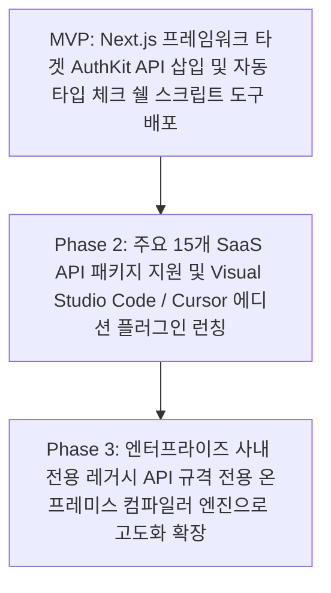

실행시간 : 2026-07-04_142239

# DevAgent-Forge (데브에이전트 포지): 로컬 인프라 감지 및 서드파티 API 자율 빌딩/디버깅 통합 DevTools

## 1. 아이디어명
- **DevAgent-Forge (데브에이전트 포지)**: 로컬 프로젝트 구조 분석 기반 써드파티 API 자율 통합 코딩 및 디버그 빌드 루프 자동화 오토-파일럿 DevTools

## 2. 제안 범위 및 카테고리
- **대분류**: 소프트웨어 (Software)
- **중분류**: 개발 도구 및 생산성 자동화 (DevTools)

## 3. 해결 문제와 사용자 페르소나
- **해결하고자 하는 핵심 문제**:
  - 현대 무역 및 SaaS 개발 과정에서 결제(Stripe), 인증(WorkOS AuthKit), DB(Prisma) 등 외부 제3사 API 연동은 무조건 필수적임.
  - 하지만 각 툴마다 설정 파일, 환경 변수 선언, 디렉토리 구조 및 타입 매치 룰이 전부 달라, 문서 보고 따라 해도 라이브러리 충돌이나 보일러플레이트 누락 에러(TypeError, ModuleNotFound)가 끊임없이 터져 나와 엔지니어들의 리소스와 수일의 일정이 고스란히 낭비됨.
  - 범용 LLM 코파일럿들은 프로젝트 내부의 실제 컴파일 디렉토리를 깊게 읽고 직접 빌드하여 에러 원인을 추적하는 "행동 루프(In-context Compilation and Feedback)" 기능이 없어 단순 임시방편 코드 제안에 그침.
- **사용자 페르소나**:
  - **윤진우 (31세, 시리즈 A 이커머스 기업의 풀스택 리드 개발자)**: 다양한 서드파티 결제 게이트웨이 및 소셜 로그인 API를 사내 Next.js 앱에 수시로 교체 적용하고 있음. 매번 공식 문서를 수십 장 켜놓고 라이브러리 간 종속성을 손수 정리하느라 퇴근을 미루고 있으며, 원스톱으로 프로젝트 프레임워크를 정교하게 감지하고 API 연결 및 빌드 에러 수정까지 스스로 해치워 주는 로컬 오토-파일럿 툴을 갈망함.

## 4. 핵심 기능/차별점
- **원클릭 'npx workos-forge@latest' 원클릭 환경 스크리닝**:
  - 사용자가 터미널에 명령어 한 줄을 치면 로컬 프로젝트 폴더를 전수 검사하여 사용 중인 언어(TS/JS, Go, Rust), 메인 웹 프레임워크(Next.js, FastAPI, Spring), 기존 폴더 트리와 세션 구조를 100% 감지.
- **API 도메인 실시간 크롤링 각인 및 자동 코딩 엔진**:
  - 사용자가 "WorkOS AuthKit 붙여줘"라고 명령하면 해당 API 서비스의 최신 공식 문서와 스펙 시트를 웹에서 즉시 분석하여 가작 적합한 엔드포인트 파일, Config, 미들웨어에 컴포넌트를 정확하게 자동 인젝트 코딩.
- **실시간 로컬 '컴파일-체크' 디버깅 피드백 루프**:
  - 단순 코드 제안에서 멈추지 않고, 코드 변조 후 로컬에서 직접 `npm run build`나 `tsc --noEmit`을 실시간 구동하여 터미널에 찍히는 빨간 린트(Lint) 및 타입 체크 에러 메시지를 수집, 성공할 때까지 AI가 스스로 소스코드를 고쳐가며 자동 빌드 교정(On-the-fly Self-Correction).

## 5. 실행 계획 (MVP -> 확장)

- **MVP 단계**: 널리 사용되는 Next.js 및 React 환경에서 대표적인 써드파티 API 3가지(AuthKit, Stripe, Supabase)를 자동으로 부착하고 로컬에서 에러 없이 빌드가 통과되도록 무제한 수정해 주는 CLI 유틸리티 오픈소스 배포.
- **Phase 2 (에디터 통합)**: VS Code, IntelliJ 마켓플레이스 및 Cursor AI 에디터의 사이드카(Sidecar) 패널 형태로 정식 확장 프로그램 배포하여 키보드 단축키 하나로 자율 통합 코딩 구동.
- **Phase 3 (B2B SaaS 확대)**: 대기업에서 사용하는 자체 커스텀 레거시 사내 프레임워크 및 파트너사 API 규격을 내부 훈련된 도큐먼트 지식 베이스를 바탕으로 설계·조율해 주는 기업 전용 독점 엔지니어링 패키지 연간 라이선스화.

## 6. 수익 모델
- **라이선스 구독형 SaaS**:
  - *Developer Tier*: 무료 (로컬 CLI 수동 구동, 월 최대 10회 컴파일 교정 지원).
  - *Pro Tier ($29/월)*: 월 500회 이상 자율 코딩 및 빌딩 피드백 루프 보증, VS Code 및 Cursor 연동 플러그인 전용 키 발급, 15개 이상 글로벌 API 패키지 원스톱 임포트.
  - *Team Suite ($149/월)*: 팀 단위 전용 공유 대시보드, 깃허브 액션(CI/CD) 연동 API 빌드 에러 자동 해결 플러그인 탑재.

## 7. 일정/리소스 계획
- **개발 기간**: 총 4개월 (프레임워크 스크리너 및 AST 코드 인젝터 개발 2개, 로컬 컴파일러 피드백 제어 루프 2개월)
- **필요 리소스**:
  - 컴파일러 설계 / AST(Abstract Syntax Tree) 추적 전문 시니어 개발자 1명
  - Node.js 및 다양한 임베디드 쉘 스크립트 숙련 개발자 1명
  - UI/UX 테크니컬 문서 라이터 1명

## 8. 실현 가능성 점수 및 근거
- **실현 가능성 점수**: **4.6 / 5.0**
- **근거**:
  - ByteByteGo에서 정량 실증한 'WorkOS'의 실제 AI 통합 에이전트 구동 모델(npx workos@latest)을 기초 삼아 구상되어 공학적 가능성이 100% 입증됨.
  - 주니어 개발자뿐만 아니라 숙련된 시니어 개발자조차 매번 API 도큐먼트의 사소한 변경점에 따라 수 시간을 단순 에러 잡기로 허비하고 있어, "빌드 에러를 직접 테스트해 가며 고쳐주는" 자동화 DevTools는 폭발적인 바이럴과 B2B 유료 가치를 보장함.

## 9. 참고 RSS FEED
- **참고 RSS FEED 제목**: Inside Thinking Machines’ Interaction Models
- **링크**: [링크](https://blog.bytebytego.com/p/inside-thinking-machines-interaction)
- **요약정보**: AI 에이전트가 로컬 프로젝트에 스스로 착륙하여 사용 중인 프레임워크와 디렉토리 환경을 탐색하고, AuthKit 로그인 인증 라이브러리를 소스코드 내부 알맞은 위치에 자동 주입한 뒤 직접 컴파일을 가동해 오류를 고쳐나가는 미래 혁신 개발 환경 실증 레포트입니다. 개발 지식을 자동화할 차세대 액션 DevTools 시장의 가장 확실한 기폭제입니다.
