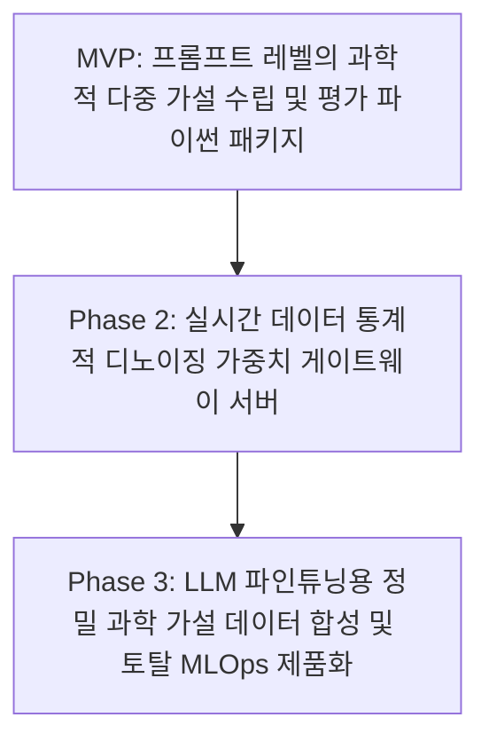

실행시간 : 2026-07-04_142410

# Ambiguity-Resolver (앰비규이티 리졸버): 복잡한 과학 데이터 추론 및 가설 트리거용 MLOps 지능형 가드레일

## 1. 아이디어명
- **Ambiguity-Resolver (앰비규이티 리졸버)**: 과학 연구용 AI 에이전트의 데이터 모호성 디노이징 및 다중 가설 추론 최적화 MLOps 게이트웨이

## 2. 제안 범위 및 카테고리
- **대분류**: 데이터 및 인공지능 (Data & AI)
- **중분류**: MLOps (과학 특화 LLM 에이전트 가드레일 및 인퍼런스 엔진)

## 3. 해결 문제와 사용자 페르소나
- **해결하고자 하는 핵심 문제**:
  - 실제 생물학, 재료공학 등 첨단 과학 데이터는 설계 도면이나 소스코드처럼 정형화되어 있지 않고 극심한 모호성(Ambiguity)과 고농도의 노이즈를 포함함.
  - 최신 AI 모델과 자율 에이전트들이 이러한 로우 데이터를 입력받을 때, 노이즈를 실제 물리적 시그널로 잘못 확신하여 거짓 가설을 수립하는 치명적인 "과적합(Overfitting) 및 오판(Misjudgment)"이 상시 발생함.
  - LLM 자체 프롬프트 튜닝이나 기본 가이드라인 수준으로는 복잡한 과학 분야의 논리적 딜레마를 완화할 수 없어, 데이터 수집 시점부터 에이전트의 가설 검증 단계까지 정밀하게 보정하는 MLOps 인프라가 필요함.
- **사용자 페르소나**:
  - **최민경 (41세, 국책 바이오 연구원 및 분자의학 연구그룹 리더)**: AI를 이용해 단백질 폴딩 기반의 타겟 억제제를 발굴하는 프로젝트를 수행 중. AI 에이전트가 실험 데이터 상의 정량적 노이즈를 새로운 약물 결합 시그널로 인식하는 바람에 수억 원 규모의 전임상 합성 실험을 몇 차례 무위로 날림. AI 에이전트가 내리는 추론 신뢰도와 가설의 모호성 극복 여부를 사전에 정밀하게 통제하고 싶어 함.

## 4. 핵심 기능/차별점
- **다중 독립 가설 추론 엔진 (Multi-Hypothesis Reasoning Orchestrator)**:
  - 입력 데이터가 모호할 때 에이전트가 단 한 가지 성급한 결론을 도출하지 않도록, 상호 대치되거나 보완적인 여러 과학 가설들을 병렬로 구조화 및 트리거하고 추론 경로를 추적함.
- **베이지안 시그널 디노이징 레이어 (Bayesian Scientific Denoising Layer)**:
  - 수치 및 도메인 데이터의 신뢰성을 통계학적으로 모델링하고, 통계 모델 기반의 노이즈 비율을 AI 에이전트에 가중치 및 페널티 점수(Confidence Score)로 지속 피드백하여 근거 중심의 추론을 유도함.
- **GeneBench-Pro 모호성 점수(Ambiguity Score) 실시간 디스플레이 및 평가 API**:
  - 실시간 추론 시마다 현 에이전트의 결정이 OpenAI GeneBench-Pro 표준 하에서 얼마나 위험하거나 자의적으로 모호한 논리를 취하고 있는지 수치화하여 모니터링 로그에 찍어주는 게이트웨이 인터페이스.

## 5. 실행 계획 (MVP -> 확장)

- **MVP 단계**: 단일 과학 쿼리가 들어왔을 때, 자체 개발한 베이지안 확률 결합 프롬프팅 모듈을 통해 에이전트에게 5가지 갈래의 상반된 학술적 가설과 점수를 유도해 주는 경량 Python 라이브러리(pip install 가능) 배포.
- **Phase 2 (게이트웨이 고도화)**: API 호출 중간에서 모호한 컨텍스트를 스스로 디노이징하고 가설 트리 형태의 구조로 LLM 응답을 자동 리디렉팅해 주는 고성능 실시간 게이트웨이 대시보드 및 서버 구축.
- **Phase 3 (데이터 합성 및 MLOps화)**: 과학 에이전트가 겪었던 실패 경로와 모호성 해결 프로세스의 추론 궤적(Reasoning Trajectories)을 데이터화하여 전용 파인튜닝용 합성 데이터를 생성하고 이를 토대로 최고 사양의 기업 맞춤형 AI 모델 연구 파이프라인 완성.

## 6. 수익 모델
- **인프라 사용료 (API Gateway 종량제 및 요금제)**:
  - *Free/Research Tier*: 매월 1,000건의 API 호출 무료, 기본 가설 트리 수집.
  - *Academic/Standard Tier ($399/월)*: 매월 10만 건 API 호출, 다중 가설 및 베이지안 디노이징 기능 탑재.
  - *Enterprise Custom*: 무제한 API 연동, 자사 연구 데이터베이스 특화 노이즈 필터링 모델 구축, 가설 궤적 추적 연동.
- **가설 학습용 합성 데이터 세트 판매**:
  - AI 생물학/화학 에이전트 성능을 극적으로 올려주는 가설 추론 로그 데이터셋 라이선스 건당 라이선싱 수수료 수취.

## 7. 일정/리소스 계획
- **개발 기간**: 4개월 (베이지안 추론 엔진 및 프롬프팅 모듈 2개월, MLOps 게이트웨이 시스템 구축 2개월)
- **필요 리소스**:
  - 수학/통계 및 LLM 아키텍처에 능한 AI R&D 연구원 1명
  - MLOps 및 고성능 API 분산 시스템 백엔드 엔지니어 1명
  - 프론트엔드 대시보드 엔지니어 1명

## 8. 실현 가능성 점수 및 근거
- **실현 가능성 점수**: **4.5 / 5.0**
- **근거**:
  - 챗GPT의 전 세계적 확산으로 대중적인 영역 외에 과학, 공학계의 딥테크(Deep-tech) AI 활용 니즈가 최고조에 달했습니다.
  - 연구용 예산 및 펀딩 규모가 크고, 단 한 번의 실험 실패로 수십 억 원이 증발하는 신약/신물질 개발 필드에서는 "데이터 모호성 제거 및 신뢰할 수 있는 가설 관리" 소프트웨어에 지불하는 예산 저항감이 매우 작아 상업적 가능성이 극단적으로 높습니다.

## 9. 참고 RSS FEED
- **참고 RSS FEED 제목**: [OpenAI Blog] Introducing GeneBench-Pro
- **링크**: [URL](https://openai.com/index/introducing-genebench-pro)
- **요약정보**: OpenAI가 과학 연구용 에이전트가 복합 생물학 문제를 헤쳐나가는 과정을 측정하기 위해 GeneBench-Pro를 설계했다는 기술 보고서입니다. 데이터의 모호성과 실제 시그널을 혼동하는 문제를 정밀하게 짚어내고 있으며, 이에 특화된 추론 모델과 보정 인프라의 필요성을 명징하게 설명합니다.
