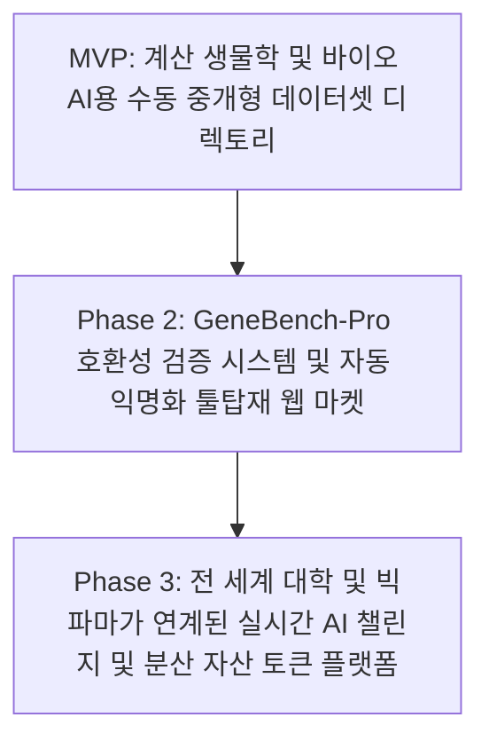

실행시간 : 2026-07-04_142410

# GeneBench-Exchange (진벤치 익스체인지): 계산 생물학 AI 평가 데이터셋 및 커스텀 타스크 분산 마켓플레이스

## 1. 아이디어명
- **GeneBench-Exchange (진벤치 익스체인지)**: 계산 생물학 및 바이오 테크 AI 에이전트 벤치마킹 데이터셋 유통 마켓플레이스

## 2. 제안 범위 및 카테고리
- **대분류**: 서비스 및 플랫폼 (IT Services)
- **중분류**: Marketplace (신약개발 및 생명공학 특화 데이터 & 챌린지 시나리오 중개 플랫폼)

## 3. 해결 문제와 사용자 페르소나
- **해결하고자 하는 핵심 문제**:
  - OpenAI가 발표한 GeneBench-Pro 등을 기반으로 많은 바이오테크 및 제약업체들이 AI 에이전트를 도입하고 있으나, 연구 현장마다 다루는 분자나 단백질, 세포 군의 성격이 완전히 달라 범용 벤치마크만으로는 우리 연구실 에이전트의 신뢰성을 완벽히 가늠하기 어려움.
  - 전 세계 독립 연구소나 대학 연구원들이 보유한 '정제된 바이오 실험 데이터와 모호성 해결의 노하우(가설 수립 이력)'는 가치가 매우 높음에도 불구하고, 안전하고 합법적으로 판매 및 유통하여 수익화할 글로벌 채널이 부재함.
  - 보안과 라이선스가 확실하고 민감 정보를 익명화한 상태에서 AI 학습/평가용 고품질 도메인 데이터를 거래하는 특화 플랫폼이 매우 목마른 상황임.
- **사용자 페르소나**:
  - **헨리 아놀드 (Henry Arnold, 48세, 스위스 기반 중견 제약사 AI 신약개발 헤드)**: 특정 종양 마커 단백질의 결합력을 예측하는 AI 에이전트를 파인튜닝 중. 학습 결과와 예측 안정성을 내부의 좁은 샘플로만 검증하기에 불안하여, 유사한 종양 유전학 분야의 실제 임상 정제 로 데이터셋이나 이미 검증된 고난도 벤치마크 타스크가 필요하나 마땅히 살 수 있는 통로가 없어 답답함.

## 4. 핵심 기능/차별점
- **GeneBench-Pro 호환 타스크 검증 및 라이선싱 자동화**:
  - 판매자가 업로드한 커스텀 바이오 데이터셋이 GeneBench-Pro 규격의 유효성을 통과하는지 메타 검증을 완료한 후, 자동화된 라이선스 계약서(Smart Contract / Legal-Tech Template)를 생성하여 지식재산권을 보호함.
- **민감 생물학 정보 익명화(De-identification) 툴킷**:
  - 환자 정보나 기밀 특허 물질의 골격 등 민감 데이터를 머신러닝 학습 및 가치 평가에 필수적인 논리적 벡터와 수학적 정보 수준으로 완벽하게 마스킹·가공하여 안심하고 유통할 수 있도록 지원하는 패키지 내장.
- **AI 에이전트 평가용 양방향 챌린지 샌드박스**:
  - 구매자가 단순히 파일 다운로드가 아닌, 자사의 AI 에이전트 API 키만 등록하면 GeneBench-Exchange 플랫폼이 호스팅하는 실시간 비밀 벤치마크 챌린지 타스크에 접근해 스코어 성적표를 즉석에서 발급받는 고성능 프라이빗 실행 가상 서빙.

## 5. 실행 계획 (MVP -> 확장)

- **MVP 단계**: 검증된 몇몇 대학 연구실들과 독점 계약을 체결하여 정제된 계산 생물학 데이터셋 20여 종을 안전하게 웹에 전시하고 바이어를 수동 매칭하는 폐쇄형(Curated) 마켓 베타 론칭.
- **Phase 2 (자동 검증 및 웹 플랫폼)**: 판매자가 직접 데이터를 업로드하면 AI가 구조를 파싱해 민감 정보를 마스킹하고, GeneBench-Pro 벤치마크 지표 호환성 검사 및 정량적 가격 측정 알고리즘을 연동하는 대규모 개방형 거래 서비스 시작.
- **Phase 3 (챌린지 서비스 및 글로벌 확장)**: Kaggle의 생물학 AI 버전처럼 연구소들이 자사 문제(Challenge)를 상금과 함께 올리고, 수많은 바이오 에이전트들이 이를 돌려 최고 솔루션을 즉석에서 매칭하여 지식 재산을 소유하는 크라우드소싱 연구망으로 진화.

## 6. 수익 모델
- **거래 중개 수수료**:
  - 데이터셋 판매 및 챌린지 라이선스 계약 성사 시 총 거래 대금의 15%를 수수료로 수취.
- **데이터 안심 가공 및 컨설팅 피(SaaS API 요금)**:
  - 판매자를 위한 익명화 솔루션 및 데이터 정제 정량화 검증 SDK 이용료 월 99달러 구독형 또는 건당 요금 부과.
- **엔터프라이즈 프라이빗 챌린지 호스팅 요금**:
  - 외부 노출을 원치 않는 제약사를 위해 완전 격리망에서 챌린지를 열고 에이전트 평가를 대행해 주는 엔터프라이즈 컨설팅 계약 (최소 건당 $10,000 이상).

## 7. 일정/리소스 계획
- **개발 기간**: 6개월 (익명화 모듈 및 라이선스 프레임워크 3개월, 마켓플레이스 웹 인터페이스 및 결제/다운로드 보안 인프라 3개월)
- **필요 리소스**:
  - 백엔드 보안 및 거래 정산 빌링 시스템 개발자 1명
  - 바이오테크/생화학 데이터 및 거버넌스 규제 전문가 1명
  - 프론트엔드 UI/UX 개발자 1명

## 8. 실현 가능성 점수 및 근거
- **실현 가능성 점수**: **4.1 / 5.0**
- **근거**:
  - ChatGPT의 전 세계적 침투와 더불어 고난도 도메인인 '바이오/의학 AI' 시장은 차세대 빅테크 투자금이 폭발하는 핵심 타겟 분야입니다.
  - 데이터의 고품질 저작권 보호 및 지식 자산화는 시장 참여자들이 기꺼이 막대한 수수료를 지불하게 만드는 확실한 락인 요소입니다. 법률 규제 및 저작권에 대한 도메인 특화 법무 구조를 선점한다면 후발 주자가 절대로 넘볼 수 없는 독점 플랫폼이 될 수 있습니다.

## 9. 참고 RSS FEED
- **참고 RSS FEED 제목**: [OpenAI Blog] Inside Genebench-Pro / Introducing GeneBench-Pro
- **링크**: [URL](https://openai.com/index/genebench-pro/case-studies)
- **요약정보**: OpenAI가 다양한 제약 연구실의 계산 생물학 사례 연구를 분석하며 GeneBench-Pro를 설계했고, AI 에이전트가 현실 생명 공학 도메인에서 올바르게 가설을 제어하고 대처하게 하려면 더 가치 높은 시나리오 데이터의 축적과 보급이 필요하다고 피력한 레퍼런스 데이터입니다.
