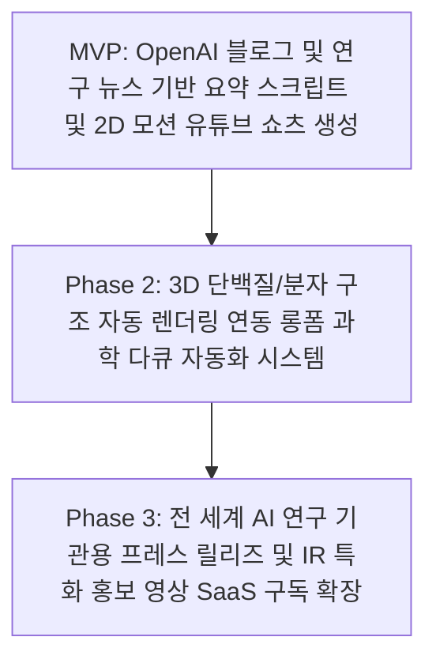

실행시간 : 2026-07-04_142410

# SciShowrunner-AI (사이쇼러너 AI): 바이오 테크 및 과학 AI 에이전트 성공/실패기 전문 3D 애니메이션 자동화 채널

## 1. 아이디어명
- **SciShowrunner-AI (사이쇼러너 AI)**: AI 연구 에이전트의 생물학 탐험 및 가설 실패/성공 로그를 다루는 스토리텔링 전문 3D 애니메이션 자동 생성 미디어 채널

## 2. 제안 범위 및 카테고리
- **대분류**: 유튜브 콘텐츠 및 미디어 (YouTube & Media)
- **중분류**: AI Automation (시나리오 자동화, 3D 가상 그래픽 렌더링 및 과학 다큐멘터리 제작 자동화)

## 3. 해결 문제와 사용자 페르소나
- **해결하고자 하는 핵심 문제**:
  - 현대 대중과 지식층 및 테크 투자자들은 AI 기반의 바이오테크, 양자컴퓨터, 기후위기 시뮬레이션 등에 막대한 관심을 쏟고 있으나, "신약 타겟을 발굴하고 시퀀싱 데이터의 모호성을 해결했다"는 구체적인 기술 성과는 극도로 이해하기 힘들고 지나치게 전문적이어서 마케팅 및 대중 소통에 매번 실패함.
  - 이로 인해 과학 미디어 분야는 자극적인 짜깁기 가짜뉴스나 원리 없는 설명글이 알고리즘을 타며 미디어 오염이 심각한 상태임.
  - AI 에이전트가 어떤 모호성(Ambiguity)에 부딪혔고, 이를 어떤 시행착오와 논리 분석을 거쳐 해결해 나갔는지 그 지적 탐험 과정을 시각적이고 대중 친화적인 '3D 다큐 애니메이션 내러티브'로 자동 변환해 흥미와 신뢰를 모두 충족하는 솔루션이 부재함.
- **사용자 페르소나**:
  - **오상훈 (32세, 구독자 45만 테크/과학 대중 채널 유튜브 크리에이터)**: 매주 트렌디하고 정확한 글로벌 AI 연구 소식을 알기 쉽고 비주얼 좋게 전달하여 조회수를 늘리고 싶어 함. 하지만 바이오 논문이나 OpenAI의 GeneBench-Pro 벤치마크 같은 첨단 뉴스를 소화해 직관적이고 몰입감 높은 3D 그래픽 영상으로 제작하는 것은 제작비가 주당 수백만 원에 육박하고 전문 지식이 부족하여 한계에 직면함.

## 4. 핵심 기능/차별점
- **에이전트 탐행 궤적(Reasoning Trajectory)의 드라마타이즈 엔진**:
  - BioGate-Sim 이나 GeneBench-Pro 로그에서 수집된 AI 에이전트의 생각 변화와 모호성 해결의 과정을 파싱하여, '발단-전개-위기(할루시네이션/에러)-극복-성공'이라는 전통적인 스토리 구조의 드라마 대본(스크립트)과 내레이션을 자동으로 집필함.
- **WGL & Blender API 기반 3D 분자/단백질 상호작용 그래픽스 자동 생성**:
  - 바이오 에이전트가 탐색했던 3D 화학 물질 구조나 단백질 나선, 유전자 서열 맵 데이터(PDB 파일 등)를 끌고 와서 고해상도 3D 인터랙티브 렌더링으로 가공하고, 카메라 워킹을 자동 생성해 화려한 SF 다큐풍의 미려한 영상 클립으로 출력.
- **AI 과학 버추얼 호스트 및 성우 합성 통합 파이프라인**:
  - 팩트 검증 기능(KCST 등 공인 가이드 매칭)을 내재화하여 거짓 정보를 방지하고, 다국어 TTS 엔진과 버추얼 아바타가 유려한 톤으로 복잡한 개념을 재치 있게 설명해 주는 가상 쇼러너 캐릭터 실시간 오디오-비디오 씽크.

## 5. 실행 계획 (MVP -> 확장)

- **MVP 단계**: 매일 업로드되는 OpenAI Blog 등의 첨단 연구 성과를 소화해 AI 에이전트가 활약하는 60초 분량의 매혹적인 쇼츠 영상용 대본과 이미지를 생성하고 자동 편집하는 툴 구축 후 테스트 채널 론칭.
- **Phase 2 (3D 자동 렌더링 및 롱폼)**: 로컬 렌더러 서버를 가동해 복잡한 유전자 전사 과정이나 계산 생물학 시뮬레이션 데이터를 자동으로 Blender 3D 카메라 씬으로 빌드하고, AI 버추얼 호스트가 15분짜리 수준 높은 과학 다큐멘터리 급 롱폼 영상을 원스톱 생성하는 플랫폼 구현.
- **Phase 3 (B2B 및 학회 IR 파트너십)**: 신약 개발 스타트업이나 생명과학 학회가 자신들의 복잡한 AI 연구 성과를 한 번에 대외 홍보 및 투자 유치용(IR) 비디오로 변형할 수 있도록 해주는 엔터프라이즈 마케팅 자동화 미디어 비즈니스로의 본격적 확장.

## 6. 수익 모델
- **콘텐츠 광고 및 스폰서십 (미디어 채널)**:
  - 프리미엄 테크/글로벌 과학 채널 운영을 통한 유튜브 AdSense 수익 및 첨단 과학 기기, AI 도구 브랜드의 유료 브랜디드 콘텐츠 스폰서십.
- **SaaS 정기 구독 패키지 (제작 대행 툴)**:
  - *Basic ($49/월)*: 중소 유튜버 전용, 텍스트 입력 시 월 10개 쇼츠 영상의 자막/대본 및 배경 그래픽 가편집 자동화.
  - *Professional ($249/월)*: 월 10개의 3D 물리/화학 렌더링이 가미된 롱폼 과학 비디오 생성 가동.
  - *Enterprise Custom*: 대학 연구소, 신약 팹리스 B2B 타겟 마케팅 및 IR 피칭 전용 고해상도 3D 비디오 프로덕션 전용 라이선스.

## 7. 일정/리소스 계획
- **개발 기간**: 4개월 (스토리텔링 대본 변환 알고리즘 2개월, Blender 3D 자동 카메라 및 프레임 렌더링 자동화 2개월)
- **필요 리소스**:
  - Python 기반 Blender API 및 3D 컴퓨터 그래픽스 전문 엔지니어 1명
  - 시나리오 및 스토리텔링 생성 연구 LLM 프롬프트 엔지니어 1명
  - 모션 그래픽스 비디오 아티스트 겸 디자이너 1명

## 8. 실현 가능성 점수 및 근거
- **실현 가능성 점수**: **4.4 / 5.0**
- **근거**:
  - ChatGPT의 전 세계적 글로벌 확산은 IT 전반에 깊고 넓은 지적 갈증을 자극했으며, 단순 잡담이 아닌 '첨단 과학 AI'를 주제로 하는 고품질 에듀테인먼트(Edutainment) 미디어 시장의 프리미엄화 가치는 기하급수적으로 폭증 중입니다.
  - 이미 수많은 유튜브 대형 테크 채널들이 그래픽 제작비와 검증의 어려움을 토로하고 있어, 이 프로세스를 자동화·도구화해 주는 솔루션은 전 세계 테크 미디어 크리에이터들에게 가장 빠르게 바이럴될 수 있는 킬러 아이디어입니다.

## 9. 참고 RSS FEED
- **참고 RSS FEED 제목**: [OpenAI Blog] How ChatGPT adoption has expanded
- **링크**: [URL](https://openai.com/index/how-chatgpt-adoption-has-expanded)
- **요약정보**: 글로벌 시장 전체에서 ChatGPT의 도입율과 이용 깊이가 점차 깊어지고 세련되며 개인의 탐구 반경이 다양화되고 있음을 보고하는 자료입니다. 지적 수준이 한층 고도화된 글로벌 지식 대중을 만족시킬 고밀도 비주얼 테크 콘텐츠 솔루션의 잠재력이 매우 큼을 보증합니다.
