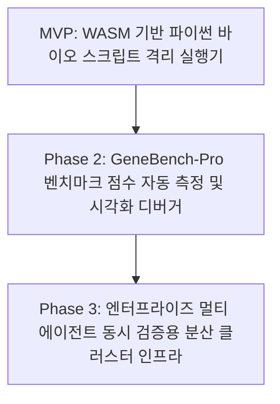

실행시간 : 2026-07-04_142410

# BioGate-Sim (바이오게이트 심): AI 에이전트 전용 계산 생물학 워크플로우 시뮬레이션 및 검증 샌드박스

## 1. 아이디어명
- **BioGate-Sim (바이오게이트 심)**: AI 연구 에이전트를 위한 계산 생물학 워크플로우 안전성 시뮬레이션 및 샌드박스 테스팅 플랫폼

## 2. 제안 범위 및 카테고리
- **대분류**: 소프트웨어 (Software)
- **중분류**: DevTools (AI 에이전트 전용 샌드박스 및 생물정보학 안전 평가 툴)

## 3. 해결 문제와 사용자 페르소나
- **해결하고자 하는 핵심 문제**:
  - 생물정보학 및 계산 생물학(Computational Biology) 영역에서 AI 에이전트는 복잡한 시퀀싱 파일 분석, 유전자 타겟 자동 서칭, 가설 검증용 파이썬 스크립트 작성 등 매우 민감한 파일과 인프라를 건드리며 구동됨.
  - 하지만 AI 에이전트가 생성한 바이오 스크립트나 코드 조각이 실제로 생물학적 규칙을 올바르게 반영하는지, 자칫 잘못된 계산 룰이나 인프라 파괴적인 네트워크 스크립트를 무작위로 호출하고 있지는 않은지 안전하게 격리하고 검증할 방법이 없음.
  - 에이전트가 겪는 '모호성'의 제어가 불가능하여, 샌드박스 밖으로 가기 전에 이 에이전트의 연산 능력과 판단 신뢰성을 도메인 전용으로 사전에 평가하는 정밀 소프트웨어 도구가 필수적임.
- **사용자 페르소나**:
  - **박지호 (36세, 글로벌 면역항암제 신약 팹리스 스타트업 AI 플랫폼 팀장)**: 파이프라인 최적화에 LLM 에이전트들을 투입하여 가설 및 타겟 유전자 예측 스크립트를 밤샘 실행함. 가끔 생성된 에이전트 코드가 치명적인 인프라 오류나 잘못된 라이브러리 연산을 유발하여 실제 서버가 뻗거나 완전히 무관한 유전자를 교차 유효한 것으로 분석해 시간을 수십 시간씩 버리는 고충을 겪고 있음.

## 4. 핵심 기능/차별점
- **Computational Biology 도메인 전용 격리 격벽 (Secure Bio-Sandbox)**:
  - Docker 및 WASM 기반의 완전한 로컬 가상 환경을 가동하여 AI 에이전트가 임의로 실행하는 BLAST, GATK 등 복잡한 생물정보학 소프트웨어 도구를 안전하게 가둬서 실행.
- **GeneBench-Pro 표준 호환 검증 엔진**:
  - OpenAI의 최신 생물학 에이전트 벤치마크 표준(GeneBench-Pro)에 따라 에이전트의 애매모호한 의사결정 방식(Noise vs Biology 판단)을 점수화하고, 도커 안에서 에이전트의 판단 흐름을 실시간 시각화된 시퀀스 다이어그램으로 디버깅.
- **위험 명령어 & 오버플로우 자동 필터 (Bio-Shield Guard)**:
  - 인프라를 손상시킬 우려가 있거나 생물정보학 데이터베이스(NCBI, Ensembl) API에 대규모 악성 오버헤드를 줄 수 있는 에이전트의 무작위 트래픽 시도를 사전에 차단하고 정상화 가이드를 에이전트 컨텍스트에 역주입.

## 5. 실행 계획 (MVP -> 확장)

- **MVP 단계**: AI 에이전트가 생성한 유전자 서열 분석 파이썬 스크립트와 바이오 라이브러리를 안전하게 실행하고 정상 동작 여부를 판정해 주는 로컬 개발 패키지(CLI 및 파이썬 SDK) 제공.
- **Phase 2 (시각화 및 평가)**: 웹 대시보드를 론칭하여, 에이전트의 여러 시나리오를 돌리고 가이드라인이 부실한 상황 속에서 에이전트가 어떤 모호성을 헤쳐 나갔는지 점수를 시각화해 벤치마킹.
- **Phase 3 (엔터프라이즈 확장)**: 거대 다국적 제약사 및 신약 연구기관을 겨냥해 사내 서버 내에 폐쇄망(On-Premise)으로 구축할 수 있는 보안 바이오 에이전트 전용 DevSecOps 플랫폼 구축.

## 6. 수익 모델
- **라이선스 과금 (SaaS 구독료)**:
  - *Developer Tier (무료)*: 개인 연구자용, 하루 최대 10회 격리 검증 및 기본 에러 디버그.
  - *Pro Tier ($299/월)*: 중소 연구실용, 무제한 샌드박스 테스팅, GeneBench-Pro 표준 시나리오 50종 연동.
  - *Enterprise Tier (별도 문의)*: 제약사 및 대형 연구소용, 온프레미스 연동, 에이전트 전용 가상 전력 관리 및 멀티 클러스터링.
- **특화 마켓플레이스 수수료**:
  - BioGate-Sim 내부에서 사용할 수 있는 검증 파이프라인 룰이나 커스텀 플러그인 거래 수수료의 20%를 수취.

## 7. 일정/리소스 계획
- **개발 기간**: 5개월 (WASM/Docker 샌드박스 모듈 2.5개월, GeneBench-Pro 호환 분석 엔진 및 UI 대시보드 2.5개월)
- **필요 리소스**:
  - 가상화 및 클라우드 전문 엔지니어 1명
  - 생물정보학(Bioinformatics) 도메인 컨설턴트/개발자 1명
  - 에이전트 가이드레일 전문 LLM 엔지니어 1명
  - UI/UX 디자이너 겸 프론트엔드 개발자 1명

## 8. 실현 가능성 점수 및 근거
- **실현 가능성 점수**: **4.3 / 5.0**
- **근거**:
  - OpenAI가 가이드북이 없는 모호성 가득한 생물학 문제를 해결하는 에이전트용 벤치마크 GeneBench-Pro를 릴리즈했다는 것은, 그만큼 수많은 신약 개발 스타트업과 연구소들이 이를 체계적이고 안전하게 테스트할 실시간 도구(Sandbox)가 고프다는 숨은 반증입니다.
  - 보안 격리와 도메인 연동은 정밀하고 검증된 규격을 제공하기 때문에, 바이오 인프라 시장에서 매우 두터운 기술적 해자와 락인(Lock-in) 효과를 창출하기 용이합니다.

## 9. 참고 RSS FEED
- **참고 RSS FEED 제목**: [OpenAI Blog] Introducing GeneBench-Pro
- **링크**: [URL](https://openai.com/index/introducing-genebench-pro)
- **요약정보**: AI 에이전트가 복잡한 계산 생물학 연구 중 마주하는 노이즈와 데이터 간의 경계를 판별하고, 가이드가 생략된 모호함 속에서 적절한 판단을 내려 연구를 고도화할 수 있는지 정밀 평가하는 벤치마크 툴의 중요성을 다루고 있습니다.
