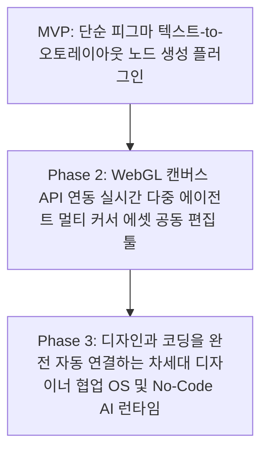

실행시간 : 2026-07-04_142417

# FigmaCanvas-Agent (피그마캔버스 에이전트): WebGL 기반 실시간 AI UI-UX 협업 다중 에이전트 오케스트레이션 엔진

## 1. 아이디어명
- **FigmaCanvas-Agent (피그마캔버스 에이전트)**: WebGL 그래픽 웹 캔버스 연동 인간-AI 실시간 공동 편집 디자인 MLOps 엔진

## 2. 제안 범위 및 카테고리
- **대분류**: 데이터 및 인공지능 (Data & AI)
- **중분류**: LLM Apps (멀티 에이전트 오케스트레이션 및 WebGL/Figma 플러그인 AI 프레임워크)

## 3. 해결 문제와 사용자 페르소나
- **해결하고자 하는 핵심 문제**:
  - 기존의 대다수 AI 디자인 제너레이터(v0, Midjourney 등)는 유저가 "텍스트를 입력하면 정적인 결과물 일회성 출력"이라는 단방향·일회성 프로세스에 머물고 있어, 실제 프로페셔널 UI-UX 디자인 과정에 스며들기 어려움.
  - 현대의 프로 디자인 환경은 피그마(Figma) 같은 '실시간 동시성 WebGL 캔버스'에서 인간과 동료가 마우스 커서들을 마구 움직이며 복합적이고 즉흥적인 레이아웃 다듬기, 그리드 조정, 에셋 조율을 함께 해나감.
  - 디자이너와 협업해 가며 캔버스 내부 오브젝트를 직접 실시간 제어하고(Vector-based manipulation), 레이어의 반응형 변형을 동시에 실행할 만한 고성능 다중 AI 에이전트 구조 및 오케스트레이터가 전무한 실정임.
- **사용자 페르소나**:
  - **김태희 (31세, 모바일 커머스 스타트업 리드 UI-UX 디자이너)**: 매번 기획자나 경영진의 다양한 피드백(예: "여기 마진 줄이고, 버튼 둥글게 깎아주시고, 카드 3개로 복제해 주세요")을 직접 손으로 받아치는 단순 노가다 작업에 시간의 70%를 낭비함. 자신이 피그마 디자인 방에서 작업하고 있을 때, AI 비서 커서들이 함께 접속하여 자기가 지시한 구체적인 기하학적 및 컴포넌트 변형 작업을 실시간으로 뚝딱 해치워 주는 '진짜 동료 AI'를 상상하고 있음.

## 4. 핵심 기능/차별점
- **Figma Live WebGL Protocol 동기화**:
  - 브라우저 WebGL 캔버스 메모리에 직접 주입되어, 캔버스 위의 노드(Node), 컴포넌트, 컬러 팔레트를 벡터 기하학적 트리(Geometry Tree)로 모델링하고 실시간으로 인간의 편집 동작과 동기화.
- **멀티 에이전트 오케스트레이션 엔진 (Layout / Style / Content)**:
  - 3가지 분야의 전문 에이전트가 병렬 작동:
    - *Layout Agent*: 컴포넌트 간 오토 레이아웃(Auto-layout) 마진과 반응형 제약 조건을 수치학적으로 조율.
    - *Style Agent*: 브랜드 토큰 및 트렌디 테마에 맞게 폰트, 그라데이션, 미려한 미이크로 애니메이션 스타일 실시간 적용.
    - *Content Agent*: 카드뷰나 랜딩페이지에 삽입될 고품질 실제 텍스트 카피라이팅과 벡터 일러스트 에셋 자동 합성.
- **상호작용 멀티플레이어 마우스 커서 아바타 (AI Multiplayer Cursor)**:
  - 인간 디자이너가 보는 화면 속에 AI 전용 햅틱 커서와 실시간 채팅창이 활성화되어, 마우스를 흔들며 협업하듯 다이내믹하게 협력 관계 형성 및 즉각적인 인터랙티브 수정 처리.

## 5. 실행 계획 (MVP -> 확장)

- **MVP 단계**: 피그마 플러그인 형태로 설치하여 프롬프트를 치면 오토 레이아웃 프레임 구조와 반응형 노드를 자동으로 예쁘게 구성해 주는 기본 디자인 자동화 툴 배포.
- **Phase 2 (실시간 다중 에이전트 캔버스)**: 피그마 라이브 협업 세션에 직접 참여하는 'AI Agent User'를 생성해, 독립된 가상 커서가 날아와 스타일과 마진을 동시에 밀고 깎는 정밀 실시간 다중 캔버스 엔진 개발 및 테스트 론칭.
- **Phase 3 (디자인 OS 및 빌더)**: 피그마를 넘어서, WebGL 및 자체 프론트엔드 빌더 환경을 합친 차세대 자율형 UI 제작 솔루션으로 변모하여 디자인 작업이 완료되는 즉시 프로덕션 React/Tailwind 코드로 컴파일하는 완벽한 No-code 생태계 구축.

## 6. 수익 모델
- **SaaS 정기 구독 모델 (협업 시트 수 과금)**:
  - *Starter Tier (무료)*: 개인 1인 디자이너용, AI 에이전트 일일 50회 편집 보조.
  - *Team Tier (시트당 $39/월)*: 팀 공유 캔버스 지원, 레이아웃/스타일/콘텐츠 전문 에이전트 3총사 상시 활성화, 실시간 마우스 커서 협업 무제한.
  - *Enterprise Tier (시트당 $99/월)*: 사내 독자 브랜드 디자인 시스템(Design System/Token) 강제 주입 학습 기능 제공, 전용 보안 샌드박스, API 데이터 자산 독립화.

## 7. 일정/리소스 계획
- **개발 기간**: 5개월 (Figma API 및 WebGL 벡터 렌더러 연동 2개월, 멀티 에이전트 협업 조율 및 프롬프트 아키텍처 2개월, AI 커서 인터랙션 및 프론트 개발 1개 월)
- **필요 리소스**:
  - WebGL / Canvas 기반 그래픽스 가속 전문 프론트엔드 개발자 1명
  - AI 에이전트 멀티 스레드 오케스트레이터 아키텍트 1명
  - UI-UX 인터랙션 전문 제품 디자이너 1명

## 8. 실현 가능성 점수 및 근거
- **실현 가능성 점수**: **4.4 / 5.0**
- **근거**:
  - Figma CEO 딜런 필드가 밝혔듯, 디자인 협업 툴의 파워는 브라우저 내 'WebGL을 통한 협업 시각화 브레이크스루'에서 기인하며, 이것이 디자인 도구를 운영체제 수준으로 끌어올렸습니다.
  - 이제 단순히 동떨어진 결과물 이미지만 제안하는 단순 생성형 AI는 한계에 봉착했고, 인간의 작업장(Canvas) 내부로 직접 뛰어들어 실시간으로 노드를 지능형으로 주무르는 에이전트 모델의 기술 당위성이 매우 짙습니다. 프로 디자인 씬의 생산성을 최소 5배 이상 단축시킬 획기적이고 실용적인 AI SaaS입니다.

## 9. 참고 RSS FEED
- **참고 RSS FEED 제목**: [Stratechery] An Interview with Figma CEO Dylan Field About Design and AI
- **링크**: [URL](https://stratechery.com/2026/an-interview-with-figma-ceo-dylan-field-about-design-and-ai/)
- **요약정보**: 피그마 창업자인 딜런 필드와의 심층 인터뷰로, WebGL 브레이크스루를 디자인에 적용하며 협업을 창출해 낸 피그마의 철학적 가치를 다루고 있습니다. 디자이너가 단순히 결과를 감상하는 차원을 넘어 AI가 디자인 시스템과 동시성을 유지하는 '협업의 오퍼레이팅 시스템'으로 함께 춤춰야 함을 실증하는 리포트입니다.
