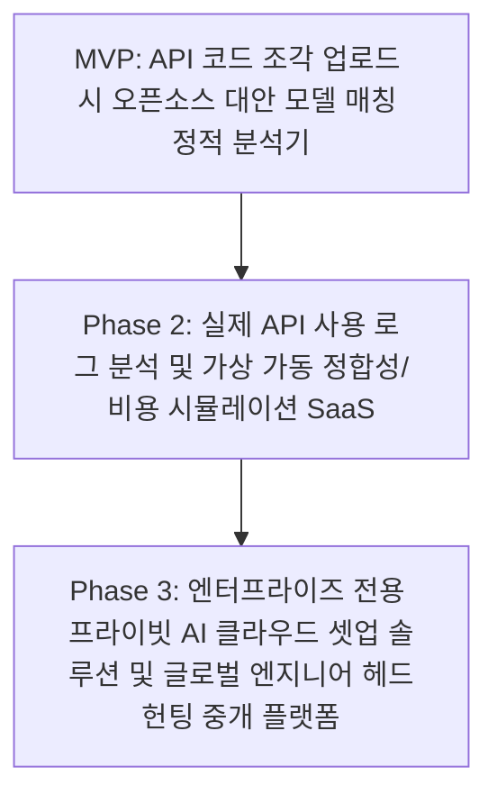

실행시간 : 2026-07-04_142417

# OSS-Gap-Match (오픈소스 갭매치): Gap Map 기반 엔터프라이즈 독점 API의 오픈소스 모델 최적 마이그레이션 평가 플랫폼

## 1. 아이디어명
- **OSS-Gap-Match (오픈소스 갭매치)**: 글로벌 AI Gap Map 연동 기업 독점 LLM API의 최적 오픈소스 전환 분석 및 컨설팅 중개 서비스

## 2. 제안 범위 및 카테고리
- **대분류**: 서비스 및 플랫폼 (IT Services)
- **중분류**: Marketplace (오픈소스 기술 마이그레이션 평가 SaaS 및 전문 엔지니어링 인력 매칭 플랫폼)

## 3. 해결 문제와 사용자 페르소나
- **해결하고자 하는 핵심 문제**:
  - 수많은 스타트업, 중견기업, 엔터프라이즈들이 서비스에 OpenAI, Anthropic 등의 비싼 상용 프론티어 AI API를 탑재하고 있으나, 사용자 증가에 따라 매달 청구되는 눈덩이 같은 API 사용료로 인해 영업적자가 심각해지고 있음.
  - 마침 글로벌 4억 달러 펀딩 기반의 'Current AI' 비영리 연합이 'Open Source AI Gap Map'을 론칭하고, 상용 모델과 견주어도 성능 격차가 거의 없는 420여 개 이상의 고품질 오픈소스 소프트웨어, 데이터셋, Llama 3 / DeepSeek 계열 모델들의 세밀한 실태 격차 지표를 공개하기 시작함.
  - 하지만 일반 기업 입장에서는 수많은 오픈소스 조합 중 자사의 복잡한 독점 API 기반 태스크(예: 특정 JSON 구조 추출, 다국어 정렬 등)를 완벽히 소화하면서 비용을 90% 이상 절감시켜 줄 최적의 '오픈소스 스택 융합'을 스스로 검증하고 인프라에 안착시킬 노하우와 전문가 인력이 극도로 부족함.
- **사용자 페르소나**:
  - **최성우 (38세, 연 매출 120억 원 규모의 AI 의료 문서 요약 스타트업 CTO)**: 매달 약 2만 달러의 OpenAI API 요금이 나와 수익성 확보에 큰 압박을 받고 있음. Llama 및 DeepSeek 기반 오픈소스 모델을 온프레미스나 자체 클라우드(Hugging Face, vLLM)로 전환하여 비용을 대대적으로 아끼고 싶으나, 사내에 실질적으로 파인튜닝과 지연율 최적화, 정합성 테스트를 안전하게 총괄할 전문 엔지니어가 없어 마이그레이션을 계속 미뤄오고 있음.

## 4. 핵심 기능/차별점
- **AI Gap Map 실시간 연동 독점-오픈소스 최적 매핑 알고리즘**:
  - 기업의 독점 API 코드 및 원시 호출 로그(Log) 파일들을 간편하게 업로드하면, Gap Map 내 266개 소프트웨어 툴, 85개 모델, 50개 데이터셋의 최신 벤치마크 데이터를 추적·계산하여 가장 완벽한 대체 오픈소스 포트폴리오 스택 설계도 발급.
- **자동화된 비용 ROI 및 정합성 테스트 샌드박스 (Cost-Performance Sandbox)**:
  - 추천된 오픈소스 모델을 임시 가상 서버(Hugging Face/AWS 가속기)에서 실제 돌려보며, 기존 API 응답 결과와 비교해 JSON 파싱 에러율, 답변 유사도, 실시간 Latency 변화 및 비용 절감액(예: "매월 84% 비용 절감 및 정확도 97.2% 유지 가능")을 시각화된 시뮬레이션 보고서로 증명.
- **오픈소스 전환 전문 프리랜서/엔지니어 매칭 마켓플레이스**:
  - 검증서를 확인한 기업들이 마이그레이션을 즉각 실행할 수 있도록, Gap Map 스택 마스터 자격증(Cert)을 획득한 전문 MLOps 엔지니어 및 시스템 설계 컨설턴트 그룹을 1대1 매칭 및 성과금 에스크로 보증 거래 지원.

## 5. 실행 계획 (MVP -> 확장)

- **MVP 단계**: OpenAI 호출 Python 스크립트를 올리면 상용 GPT-4o 대비 가장 유사한 성능의 오픈소스 Llama/DeepSeek 모델과 Hugging Face 가동 예상 호스팅 월 요금 견적서를 단 10초 만에 분석 출력하는 무료 웹 도구 배포.
- **Phase 2 (시뮬레이션 가동 및 매칭)**: API 로그를 넣으면 실제 vLLM 인스턴스를 올려 가벼운 프라이빗 추론 비교 테스트를 진행하고 데이터 마이그레이션이 필요한 복잡한 시나리오를 점수화해 주며, 이를 구현할 검증된 프리랜서 MLOps 전문가를 즉시 중개하는 마켓 결합 서비스 전격 오픈.
- **Phase 3 (엔터프라이즈 클라우드 전환 자동화)**: 대기업들을 대상으로 자사 내부망(On-premise) 혹은 하이브리드 클라우드에 완벽한 기업 전용 독자 오픈소스 LLM 및 파이프라인 아키텍처를 원클릭으로 셋업 패키징 해주고 유지 보수를 대행해 주는 엔터프라이즈 토탈 솔루션으로 고도화.

## 6. 수익 모델
- **전환 시뮬레이터 요금 (SaaS 구독료)**:
  - *Standard Tier ($199/회 또는 월 $299)*: 대화 로그 1만 건 분석, 맞춤 오픈소스 마이그레이션 아키텍처 3종 제안, 비용 ROI 정밀 시뮬레이션 패키지 다운로드.
  - *Enterprise Custom*: 무제한 인프라 진단 및 프라이빗 샌드박스 정합성 교차 테스트 가동.
- **프로젝트 성사 수수료 (Marketplace 수수료)**:
  - 매칭된 프리랜서 컨설턴트와의 마이그레이션 개발 외주 계약 성사 시 프로젝트 대금의 10%~15%를 플랫폼 중개 수수료로 취득.
- **공인 자격증 및 엔지니어 교육 프로그램**:
  - 개발자 대상 'Gap Map 마이그레이터' 인증 과정 수강료 및 자격 검정 응시 수수료 수취.

## 7. 일정/리소스 계획
- **개발 기간**: 5개월 (Gap Map 데이터 수집 및 전환 분석 알고리즘 2개월, 시뮬레이션 인프라 가상화 구축 2개월, 전문가 구인/구직 매칭 시스템 1개월)
- **필요 리소스**:
  - MLOps 및 클라우드 가상 인프라 분산 구축에 유능한 클라우드 아키텍트 1명
  - Hugging Face / 오픈소스 모델 서빙 및 양자화 파인튜닝 연구 엔지니어 1명
  - 플랫폼 결제/정산 및 커뮤니티 개발 백엔드 개발자 1명
  - 디자이너 겸 프론트엔드 개발자 1명

## 8. 실현 가능성 점수 및 근거
- **실현 가능성 점수**: **4.5 / 5.0**
- **근거**:
  - 전 세계 AI 벤처 생태계의 가장 큰 현실적 고통(Pain Point)은 비싼 AI 인프라 유지 비용입니다.
  - 4억 달러 기금으로 론칭한 Gap Map의 등장은 오픈소스 모델들이 이미 상용 모델의 턱밑까지 쫓아왔으며 비용 파괴(Cost Disruption)의 임계점이 열렸음을 상징합니다. 비용을 실질적으로 대폭 절감하고 싶은 기업들의 가려운 곳을 긁어주고, 전문 인력을 바로 찾아주는 이 플랫폼은 즉각적이고 거부하기 힘든 확실한 비즈니스 혜택(Cost ROI)을 증명하므로 매우 실현하기 쉽고 유망합니다.

## 9. 참고 RSS FEED
- **참고 RSS FEED 제목**: [Simon Willison's Blog] Open Source AI Gap Map
- **링크**: [URL](https://simonwillison.net/2026/Jul/3/open-source-ai-gap-map/#atom-everything)
- **요약정보**: 파리 AI 액션 서밋에서 출범한 4억 달러 자본의 비영리 AI 파트너십 Current AI가 공개한 오픈소스 AI 전방위 맵(Gap Map v0.1)에 대한 심층적 요약 정보입니다. 상용 독점 API 대비 421개 고품질 오픈소스 솔루션의 격차를 정교하게 짚어내고 있으며, 기업들이 합리적으로 오픈소스 모델로의 전환을 추동할 수 있는 튼튼한 이정표를 제시합니다.
