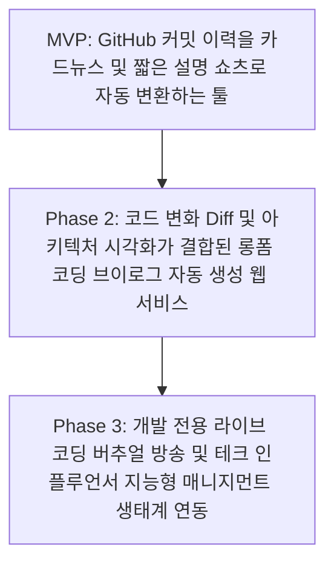

실행시간 : 2026-07-04_142417

# DevBrand-Builder (데브브랜드 빌더): 개발자의 GitHub 활동 및 테크 성과물 기반 퍼스널 브랜딩 유튜브 비디오 자동 빌더

## 1. 아이디어명
- **DevBrand-Builder (데브브랜드 빌더)**: 소스코드 저장소(GitHub) 및 개발 자산 분석 기반 퍼스널 브랜딩 미디어 자동 생성 SaaS

## 2. 제안 범위 및 카테고리
- **대분류**: 유튜브 콘텐츠 및 미디어 (YouTube & Media)
- **중분류**: AI Automation (소스코드 커밋 시계열 분석, 오디오-비디오 스토리텔링 자동 생성 및 개발자 평판 관리)

## 3. 해결 문제와 사용자 페르소나
- **해결하고자 하는 핵심 문제**:
  - Josh W. Comeau 등 글로벌 유명 에듀케이터/개발자들의 사례에서 보듯, 현대의 시니어 및 프리랜서 개발자들에게 퍼스널 브랜딩(Personal Brand)과 온라인 평판(Reputation)은 채용, 강연, 외주 수주, 독자 서비스 성공을 가르는 가장 강력한 커리어 자산임.
  - 그러나 현장 개발자들은 매일 쏟아지는 버그 수정, 릴리즈, 시스템 복구 등 일차적 작업에 치여, 정작 자신의 가치와 기술 성과를 블로그나 유튜브, 링크드인, 쇼츠 같은 소셜 미디어 포맷으로 멋지게 기획하고 비디오로 촬영·편집하여 대외 소통을 이룰 여유가 아예 없음.
  - 이로 인해 실력이 대단히 뛰어난 엔지니어가 온라인 평판 부재로 제값을 못 받거나, 반대로 실력 대비 과장된 브랜딩 해커들에게 기회와 파이를 빼앗기는 불합리한 개발 생태계 격차가 지속 발생함.
- **사용자 페르소나**:
  - **이현우 (34세, 시니어 웹 프론트엔드/백엔드 풀스택 프리랜서 개발자)**: 독립하여 고단가의 대규모 개발 프로젝트 수주와 독자 기술 전자책 판매를 목표로 하고 있음. 뛰어난 라이브러리를 몇 개 직접 오픈소스로 제작해 GitHub에 올렸으나, 이를 비디오나 매력적인 테크 브이로그로 가공해 알리지 못해 스타(Star) 수가 20개 남짓에 머묾. 유튜브 채널을 키우고 싶지만 영상 편집 및 대본 작성이 엄두가 안 나 시작을 못 함.

## 4. 핵심 기능/차별점
- **GitHub Repository 및 테크 로그 파싱 지능형 대본 컴파일러 (Git-to-Story Engine)**:
  - 개발자의 GitHub 계정 및 블로그 RSS를 연동해 두면, 주간 단위로 가장 중요한 커밋(Commit), 혁신적인 리팩토링, 이슈 해결 과정, 기여도가 높은 오픈소스 이력을 알아서 분석해 '다이내믹한 테크 브이로그/해설 대본'으로 변환.
- **코드 시각화 및 WebGL 실시간 동작 시각화 비디오 렌더러 (Code-Visualizer API)**:
  - 딱딱한 코드 텍스트만 보여주는 것이 아니라, 커밋에 따른 코드의 변화 추이(Diff), 시스템 아키텍처 다이어그램(Mermaid 등)의 움직임, 웹 결과물의 캡처 이미지를 렌더링 서버에서 수려한 모션 그래픽스 비디오 레이아웃으로 자동 연출.
- **맞춤형 버추얼 개발자 V-Tuber 및 고품질 코딩 사운드 트랙 연동**:
  - 개발자가 직접 등장하지 않아도 트렌디한 가상 아바타와 긱(Geek)한 매력의 보이스 톤(TTS)을 통해 3분 내외의 매력적인 개발자 브이로그(DevLog)를 자동 합성하고 유튜브/링크드인 규격에 맞춰 원클릭 자동 배포.

## 5. 실행 계획 (MVP -> 확장)

- **MVP 단계**: 자신의 GitHub 레포지토리 주소를 입력하면 한 달간의 주요 작업을 분석해 멋진 요약 대본과 인포그래픽 이미지 5장을 생성하고 가벼운 음성을 입혀 소셜 피드용 미니 쇼츠로 완성하는 경량 솔루션 출시.
- **Phase 2 (롱폼 코딩 브이로그 및 자동 편집)**: 실제 코드 흐름의 하이라이팅, 마우스 포인팅 모션, 개발 소리(키보드 타이핑 ASMR 등)가 음악과 유려하게 섞인 5분 분량의 완성도 높은 '롱폼 개발 소식지' 영상을 AI가 전체 자동 편집하여 제작 및 채널 업로드하는 서비스 론칭.
- **Phase 3 (자율형 라이브 코딩 및 에이전시 확장)**: AI가 개발자의 코딩 화면을 상시 분석하며 실시간 스트리밍 버추얼 방송(예: "시니어 현우의 밤샘 코딩 라이브")을 대신 연출해 주고, 이를 토대로 글로벌 구인구직 링크드인 프로필을 자동 최적화해 주는 통합 평판 비즈니스 솔루션으로 장기 안착.

## 6. 수익 모델
- **SaaS 정기 구독 모델 (개인 평판 관리용)**:
  - *Free Tier*: 월 2회 카드뉴스 및 기본 쇼츠 1편 대본 생성.
  - *Creator Tier ($49/월)*: 월 4편의 롱폼 영상 자동 렌더링 및 완성 비디오 다운로드, 유튜브/링크드인 자동 포스팅 연동.
  - *Influencer Premium ($199/월)*: 전용 3D 커스텀 버추얼 아바타 제공, 자사 오픈소스 제품 마케팅용 고해상도 아키텍처 비디오 무제한 생성, 글로벌 구인구직 상시 홍보 비서 기능 가동.
- **B2B 채용 매칭 플랫폼 수수료**:
  - 기업 인사담당자가 DevBrand-Builder 평판 포트폴리오 비디오를 보고 개발자를 다이렉트 스카우트 채용할 시, 이직 연봉의 10%를 리크루팅 중개료로 수취.

## 7. 일정/리소스 계획
- **개발 기간**: 4개월 (GitHub API 및 코드 파싱 알고리즘 2개월, 코드 텍스트/아키텍처 실시간 비디오 렌더러 개발 2개월)
- **필요 리소스**:
  - GitHub Webhook 및 코드 AST(Abstract Syntax Tree) 분석 파이썬 엔지니어 1명
  - 모션그래픽 비디오 라이브러리(FFmpeg / WebGL Video Renderer) 전문 엔지니어 1명
  - 트렌디한 감각의 UI/UX 디자이너 겸 미디어 기획자 1명

## 8. 실현 가능성 점수 및 근거
- **실현 가능성 점수**: **4.2 / 5.0**
- **근거**:
  - Josh W. Comeau 의 평판 강의가 인기를 끄는 등, 개발자 커뮤니티 전역에서 단순 코딩을 넘어 '퍼스널 브랜딩을 통한 대체 불가능한 개발 자산 구축' 니즈가 사상 최고조에 와있습니다.
  - 개발자들은 컴퓨터를 사용하고 도구를 구입하는 데 소비 장벽이 가장 낮은 고객층(Power Tech User)이므로, 자사의 성과를 대신 가치 있게 가공해 비주얼 미디어화해 주는 확실한 브랜딩 자동화 SaaS는 개발 시장에서 강력하게 각광받고 바이럴될 수밖에 없습니다.

## 9. 참고 RSS FEED
- **참고 RSS FEED 제목**: [Simon Willison's Blog] Quoting Josh W. Comeau
- **링크**: [URL](https://simonwillison.net/2026/Jul/3/josh-w-comeau/#atom-everything)
- **요약정보**: 개발자가 온라인 평판을 쌓고 개인의 브랜드를 성공적으로 수립하여 커뮤니티를 일구는 평판 구축 철학과 장기 자산화 노하우를 제공하는 블로그 포스트 분석본입니다. 개발 실력을 대중 친화적인 가치로 쉽게 번역하여 대변해 줄 미디어 자동화 브랜딩 엔진의 절실한 당위성을 지지해 주는 근거 자료입니다.
