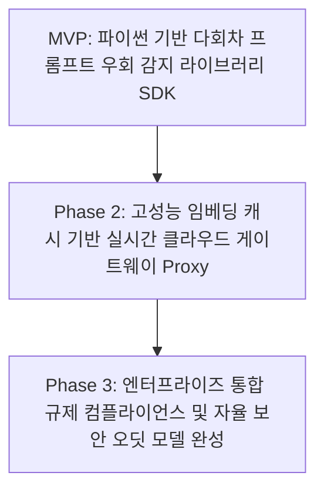

실행시간 : 2026-07-04_142417

# Jailbreak-Shield (탈옥 실드): 엔터프라이즈 프론티어 AI 보호용 다회차 프롬프트 탈옥 실시간 차단 방화벽

## 1. 아이디어명
- **Jailbreak-Shield (탈옥 실드)**: LLM 다회차 우회(Multi-turn) 및 지능형 프롬프트 탈옥 차단을 위한 실시간 지능형 MLOps 방화벽

## 2. 제안 범위 및 카테고리
- **대분류**: 소프트웨어 (Software)
- **중분류**: Cybersecurity (AI 애플리케이션 및 인프라 보안 솔루션)

## 3. 해결 문제와 사용자 페르소나
- **해결하고자 하는 핵심 문제**:
  - 최신 프론티어 LLM 모델(예: Anthropic Fable 5, GPT-4 등)들이 보안 및 정밀성 면에서 최고 사양을 보장하더라도, 악의적인 공격자들이 고안해 낸 정교한 '다회차 대화형 유해 질문(Multi-turn Adversarial Jailbreaking)' 공격에 매우 취약함.
  - 실제로 Fable 5가 이와 같은 지능형 우회 취약점을 지적받아 한시적으로 전 세계 오프라인 조치되는 사태를 겪음.
  - 기존의 단편적인 '단어 필터링'이나 '단문 차단' 식의 게이트웨이는 전체 맥락 속에 침투한 은밀한 악성 질문 유도 과정을 잡을 수 없으며, 기업들은 사내외 LLM 인프라가 사회적 합의 및 윤리 규정, 안보 룰을 어기는 대답을 노출할 위험에 완전히 방치됨.
- **사용자 페르소나**:
  - **장지훈 (39세, 금융 대기업 AI 혁신 및 보안 센터 총괄 수석)**: 자사 은행 모바일 앱에 상담 전용 Fable/Sonnet 기반 상담원을 도입했으나, 최근 뉴스에서 글로벌 빅테크 모델들이 다회차 유도 공격으로 사기 기법이나 민감 정밀 정보를 뱉었다는 소식을 듣고 비상이 걸림. 기존 솔루션들은 비싼 상용 API의 응답 속도를 지나치게 깎아먹거나 정교한 우회 패턴을 잡지 못해 골머리를 앓고 있음.

## 4. 핵심 기능/차별점
- **컨텍스트 흐름 유도 분석 알고리즘 (Contextual Flow Attack Detector)**:
  - 대화의 누적 컨텍스트를 다차원 그래프 형태로 구조화하여, 현재의 입력이 과거 대화 내용을 발판 삼아 교묘하게 안전 가이드라인의 해제를 종용하는 '가스라이팅 패턴'을 실시간 점수화 및 추적.
- **초고속 시맨틱 벡터 캐싱 및 격리 차단 (Semantic Isolation Guard)**:
  - 기존 인풋을 실시간 경량의 특화 임베딩을 통해 이미 알려진 탈옥 궤적(Adversarial Trajectories)의 코사인 유사도 벡터 데이터베이스와 비교함으로써, 응답 속도(Latency)의 손실을 0.05초 미만으로 최소화하면서 악의적 입력을 칼같이 필터링.
- **자가 치유형 보안 응답 우회 가이드 (Self-Healing Context Redirection)**:
  - 탈옥 시도가 탐지되면 즉각 사용자 대화를 격리하고, 에이전트의 시스템 프롬프트를 훼손하지 않으면서도 서비스 안전성을 유지하는 '안심 대체 응답'을 지능형으로 주입하여 서비스 가속화 및 평판 수호.

## 5. 실행 계획 (MVP -> 확장)

- **MVP 단계**: 기업의 내부 테스트용 챗봇을 위한 경량 파이썬 SDK 패키지를 릴리즈하고, 다회차 대화 세션 중 탈옥 공격 위험도가 85%를 넘을 시 플래그를 올려 알려주는 수동 로깅 패키지 배포.
- **Phase 2 (실시간 게이트웨이)**: LLM 앞단에 설치해 프록시(Proxy) 형태로 입출력을 가로채 실시간 인라인 필터링을 수행하는 고성능 클라우드 게이트웨이 서비스 론칭 및 모니터링 콘솔 연동.
- **Phase 3 (B2B 엔터프라이즈 및 규제 매칭)**: 금융, 국방, 의료 등 국가 규제가 극도로 강한 산업군을 위해 보안 심의 요건(Compliance)에 부합하는 정밀 감사 리포팅 시스템과 폐쇄망 커스텀 구축 모델 확장.

## 6. 수익 모델
- **인프라 사용료 (B2B SaaS 게이트웨이 요금제)**:
  - *Standard Tier ($499/월)*: 대형 LLM API 호출 50만 건 감시, 핵심 탈옥 데이터베이스 동기화.
  - *Enterprise Tier ($2,499/월)*: 무제한 API 호출 감시, 지연 시간 최소화 클러스터링 구성, 실시간 위협 대시보드 및 카카오톡/슬랙 경보 서비스.
  - *On-Premise License (별도 협의)*: 금융 및 국가 기관 특화, 사내 독립 서버 무제한 보안 가드 가동.

## 7. 일정/리소스 계획
- **개발 기간**: 4개월 (실시간 위협 탐지 그래프 알고리즘 2개월, 고성능 게이트웨이 분산 아키텍처 2개월)
- **필요 리소스**:
  - LLM 취약점 분석 및 AI 레드팀(Red Teaming) 보안 전문가 1명
  - Go/Rust 기반 고성능 프록시 백엔드 엔지니어 1명
  - 대시보드 프론트엔드 개발자 1명

## 8. 실현 가능성 점수 및 근거
- **실현 가능성 점수**: **4.7 / 5.0**
- **근거**:
  - OpenAI와 Anthropic의 최신 프론티어 모델들이 안보 문제로 정부 검토를 받고 Fable이 퇴출당했다 살아난 역사는 이제 "AI 보안 솔루션 없이 비즈니스 LLM 서비스를 여는 것은 폭탄을 안고 사는 것"이라는 인식을 글로벌 전역에 깊게 아로새겼습니다.
  - 전용 보안 시장은 기술 신뢰성과 긴급성이 완벽하여, 초기 기업 고객 유치 시 단가가 매우 높고 락인 강도가 압도적인 시장입니다.

## 9. 참고 RSS FEED
- **참고 RSS FEED 제목**: [Simon Willison's Blog] Fable's judgement / [The Rundown AI] Anthropic's Fable returns worldwide
- **링크**: [URL](https://simonwillison.net/2026/Jul/3/judgement/#atom-everything)
- **요약정보**: 앤트로픽 Fable 5의 다회차 탈옥 기법 노출로 인한 U.S. 정부의 긴급 중단 조치와 3주 만에 신규 가드레일을 장착하고 출시 전 정부 라이센싱 좌석을 약속하며 시장에 부활한 충격적인 사건을 상세 보증하며, 기업 서비스의 실시간 인라인 방화벽의 필수성을 대변해 줍니다.
